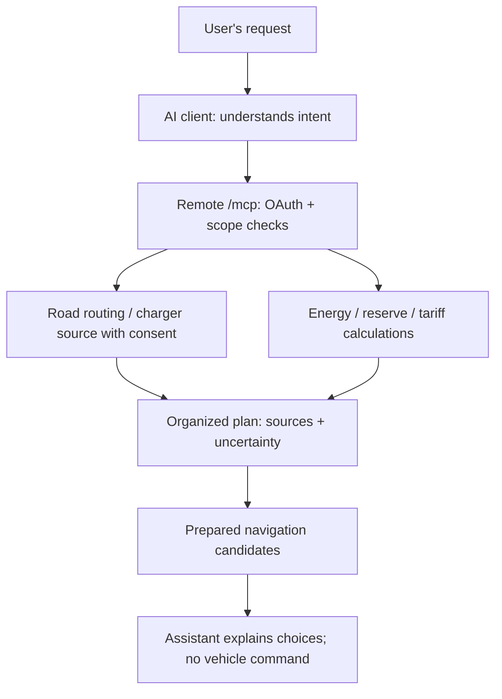

# Tesla Voice MCP

**Beyond the Tesla API: one assistant-ready layer for vehicle data, deliberate commands, trip intelligence and charging decisions.**

Tesla Voice MCP is an experimental, open-source, **self-hosted Model Context Protocol (MCP) server** that connects compatible AI clients to selected Tesla Fleet API capabilities—and combines them with road routing, energy estimates, charging-source discovery, private preferences and explicit command safeguards.

**The distinction:** Tesla Fleet API supplies authorized vehicle data and operations. **This project supplies typed MCP tools, multi-provider workflows, provenance and security gates.** Your AI client supplies conversational reasoning and, if supported, voice. It is not a model, a standalone voice app or a replacement for Tesla's official app.

> **Independent community project.** Not affiliated with or endorsed by Tesla or OpenAI. Not a hosted service or a one-click plugin. Every operator must deploy their own server, obtain their own authorization and check account, firmware, vehicle and AI-client compatibility. No live operation or 16-stop on-screen result is guaranteed.

## One MCP server, several AI clients — text first, voice where supported

The same **independently hosted remote MCP server** is designed for integration with **ChatGPT, Claude, Gemini, Grok and other compatible AI clients**. Their vendors document custom remote MCP features, so this project's integration is **expected where transport, OAuth and tool permissions align**. **No end-to-end compatibility claim for those other AI platforms is made without testing.**

```text
You speak or type -> compatible AI client -> your HTTPS /mcp -> scoped tools
                                      -> Tesla Fleet API, maps, energy, preferences
```

**Voice is NOT automatic.** A client must both support this custom MCP connector and permit tool calls during its chosen voice mode. As of this documentation review, OpenAI's general [apps FAQ](https://help.openai.com/en/articles/11487775-connectors-in-chatgpt) states that **ChatGPT Voice mode does not support apps**. xAI documents a **developer** Speech-to-Speech remote MCP path; that is not the same as universal support in a consumer Grok app.

**[AI client setup: ChatGPT / Claude / Gemini / Grok](docs/AI_CLIENTS.md)** · **[Voice capabilities and limits](docs/VOICE_USAGE.md)** · **[Compatibility test matrix](docs/COMPATIBILITY_MATRIX.md)**

**Maps:** OSM/Photon/Nominatim/OSRM-based functionality is integrated on the server side, **not a built-in graphical maps UI**. Optional Google Places API (New) can resolve Place IDs for waypoint preparation, with a separate private key, billing, consent and production gate. [Maps and providers](docs/MAP_PROVIDERS.md) · [Google Places / Place ID setup](docs/GOOGLE_PLACES_SETUP.md).

## Start here: choose your path

| New to MCP or self-hosting? | Tesla owner exploring capabilities? | Developer, integrator or security reviewer? |
| --- | --- | --- |
| **[Beginner's Guide](docs/BEGINNERS_GUIDE.md)** — safe offline trial, step by step | **[Guided demo](docs/DEMO.md)** — see synthetic end-to-end scenarios | **[Architecture & security](docs/ARCHITECTURE.md)** — implementation and trust boundaries |
| [FAQ](docs/FAQ.md) — plain-English answers | [Real workflows](docs/WORKFLOWS.md) — battery, travel, charging, commands | [Operator runbook](docs/OPERATOR_RUNBOOK.md) — deployment, diagnostics and recovery |
| [Installation](docs/INSTALLATION.md) — independent setup | [Capability reference](docs/FEATURES.md) — exact feature inventory | [All 38 MCP tools](docs/TOOLS_REFERENCE.md) and [evidence](docs/EVIDENCE.md) |

**[Full documentation index](docs/INDEX.md)** · **[Why this is more than a Fleet API wrapper](docs/WHY_MCP.md)** · **[Connect any compatible AI](docs/AI_CLIENTS.md)** · **[Google Places guide](docs/GOOGLE_PLACES_SETUP.md)**

## In one minute: what can it do?

<details>
<summary><strong>1. Ask about the car</strong> — battery, status, history, connectivity</summary>

Use timestamped cached readings without implicit wake, or explicitly request an on-demand vehicle read. Selected charging history, connectivity, schedules and app-collected samples are exposed when available. Live reads can use Tesla quota and may contact or wake the car.

**Representative tools:** `get_battery`, `get_vehicle_status`, `get_live_vehicle_data`, `get_vehicle_reading_history`, `get_charging_history`.

</details>

<details>
<summary><strong>2. Plan a trip</strong> — road distance, estimated energy, reserve</summary>

Combine supplied capacity/consumption/SOC assumptions with road distances, reserve checks and charging planning. Calculations are transparent estimates, not Tesla's internal range model.

**Representative tools:** `estimate_trip_energy`, `plan_trip`, `plan_road_trip`, `plan_charging_road_trip`, `plan_smart_trip`.

</details>

<details>
<summary><strong>3. Compare charging options</strong> — mapped stations, CCS2 candidates, tariffs</summary>

Discover charging stations through OSM and selected national data sources, plan bounded DC/HPC CCS2 stops and compare operator-supplied €/kWh and session fees. Google Places is **optional**, not required for basic OSM search.

**Representative tools:** `find_charging_sites`, `plan_charging_road_trip`, `compare_charging_costs`, `get_free_to_x_card_tariffs`.

</details>

<details>
<summary><strong>4. Prepare complex destinations</strong> — private aliases and 2–16 ordered stops</summary>

Resolve ambiguous names, use private confirmed Home/Work aliases and prepare **navigation-only itineraries of 2–16 ordered destinations**. This is source-supported and offline-tested. **Vehicle-side native/GPS multipoint delivery remains experimental**; Tesla API acceptance is not proof that all stops display in the car. Energy-mode planning allows at most eight intermediate stops.

**Representative tools:** `search_trip_destination`, `get_saved_trip_places`, `resolve_waypoint_places`, `plan_smart_trip`, `get_planned_trip`.

</details>

<details>
<summary><strong>5. Prepare and, if authorized, execute vehicle commands</strong> — gated operations and receipts</summary>

A source catalog defines **75 vehicle operation names** spanning charging, climate, access, security, navigation, vehicle/software and media. **Eight default SDK transports are unavailable** in the pinned proxy, with separately gated experiments for some navigation paths; counts are not proof of vehicle compatibility.

Commands require appropriate Tesla authorization, MCP scopes, feature gates, explicit intent and, where applicable, virtual-key pairing. Follow the preparation/confirmation or guarded direct execution path. Do not assume a receipt proves a physical result.

**Representative tools:** `get_vehicle_command_catalog`, `prepare_vehicle_command`, `execute_vehicle_command`, `execute_requested_vehicle_command`, `get_vehicle_command_status`.

</details>

## A realistic example: one request, several capabilities

> **User:** “Estimate a 230 km journey with a 15% reserve, look for CCS2 fast-charging alternatives, compare two prices I provide, and prepare the destinations. Don't send anything to the car.”



A plain Fleet API call retrieves or changes Tesla data. The workflow above **combines multiple distinct concerns** into assistant-consumable results. A custom REST application could implement comparable orchestration; MCP makes this implementation discoverable to compatible assistants. See the [fully worked synthetic scenarios](docs/WORKFLOWS.md).

## What exactly is the advantage over direct API integration?

| Direct Tesla Fleet API | Tesla Voice MCP |
| --- | --- |
| Authorized vehicle data and command endpoints | Assistant-discoverable tool catalog with schemas and per-tool OAuth scopes |
| Vehicle responses require custom UI/consumer logic | Timestamp-aware cached/live read tools and structured errors |
| External maps, route planning and price logic require separate implementation | Road routing, mapped charging candidates, energy and tariff calculators |
| Developer designs their own conversation layer | Remote MCP integration for **compatible** AI clients; client supplies the model/voice |
| Tesla-side command authorization | Additional server-side allowlists, gates, intent/confirmation flows, receipts and no-blind-retry policy |
| Native Tesla behavior depends on model/firmware | Same dependency, **plus** transparent “prepared/accepted/observed” distinctions |

**Read the full, evidence-based comparison:** [Beyond the Tesla API](docs/WHY_MCP.md). The project does not claim capabilities unavailable to traditional custom software; it packages a particular set of workflows around MCP.

## Architecture at a glance

```text
Your compatible AI client (chat / optional voice)
       |
       | MCP OAuth token — separate from Tesla OAuth
       v
Your HTTPS /mcp endpoint
       |
       +-- JWT issuer/audience/subject + per-tool scopes + feature gates
       +-- Encrypted private Redis REST store
       +-- Tesla Fleet API (authorized reads and guarded signed commands)
       +-- OSM/Photon/OSRM + optional Google Places, with consent
       +-- Station data + trip/energy/charging estimates
```

Designed for **one authorized operator per isolated instance**, not an arbitrary shared multi-user deployment.

## Try it without a Tesla

**New:** [Run an isolated first-install MCP smoke test](docs/CLEAN_ROOM_SMOKE.md) using synthetic OAuth and a temporary loopback server. It does not need Tesla/Google keys and verifies that a client can discover and call the simulated battery tool.


Requires **Node.js 22+**, **Go 1.23+** and a local checkout of the repository. From the source root:

```sh
node simulator/prepare-artifact.mjs
node --test simulator/*.test.mjs
(cd simulator && go test ./... && go build ./... && go vet ./...)
```

These are local/offline checks using synthetic fixtures, **not a deployment, Tesla login, live command or real-car test**. The separate Redis integration suite requires isolated test storage. Check the [Beginner's Guide](docs/BEGINNERS_GUIDE.md) for a non-technical walk-through and common failures.

## Costs — free software, potentially near-zero personal running costs

**The MCP software is free (MIT-licensed)**. For light personal use, you can often choose free tiers for hosting, Redis and OSM-backed maps. **Tesla Fleet API is metered**, but Tesla currently documents a **USD $10 monthly discount** for individual developers and small applications. Light usage may fall within that discount.

**Not a guaranteed free service:** Google Places (New) is optional but may charge; your AI subscription, OAuth provider, paid/commercial hosting, domain and over-limit infrastructure usage may also cost money. The size of any Tesla bill depends on actual API requests, not a flat MCP subscription.

**[Full cost and free-tier setup guide](docs/COSTS.md)** — components, official pricing, quotas and a low-cost installation path.

## Connect your own instance

A real deployment requires:

1. **Your own Tesla Fleet API application** and authorized Tesla account, including the required region/scopes; signed commands may need virtual-key pairing.
2. **Your own HTTPS host**, with the included Vercel configuration targeting `simulator/` as the project root.
3. **MCP OAuth**, separate from Tesla authorization: RS256 issuer/JWKS, resource audience `<APP_ORIGIN>/mcp`, one authorized subject and least-privilege scopes.
4. **Your own private Redis REST store** and server-side encryption key.
5. **A compatible remote-MCP AI client**, with the necessary plan/workspace permissions.
6. **Optional providers** such as Google Places (New), configured privately under their own billing and quota terms.

**[Complete installation](docs/INSTALLATION.md)** · **[AI client setup](docs/CLIENT_SETUP.md)** · **[Configuration](docs/CONFIGURATION.md)** · **[Operator runbook](docs/OPERATOR_RUNBOOK.md)**

**Costs:** no software license fee; many supporting services offer free tiers for eligible personal use. Tesla Fleet API is pay-per-use with a currently documented $10/month developer discount. Additional charges remain possible; see [Costs & Free-Tier Setup](docs/COSTS.md).

## Safety and evidence: read before using commands

- **Read-only, estimated, prepared, dispatched, provider-accepted and vehicle-observed are different states.**
- No automatic wake during cached reads and no blind retry when a command outcome is unknown.
- The 2–16 destination planner is **offline-tested**; an ordered 16-stop route visibly working on a car is **not established** by that test.
- An ordinary charger address is **not** a Tesla-native Supercharger selection and does not guarantee battery preconditioning.
- Locations can leave the deployment through consented map searches. Self-hosting does not prevent data processing by Tesla, the AI client or other selected providers.
- Never publish personal identifiers, VINs, exact GPS traces, private addresses, tokens, credential material or contract-specific tariffs.

**[Evidence and limits](docs/EVIDENCE.md)** · **[Security model](docs/SECURITY_MODEL.md)** · **[Security policy](SECURITY.md)**

## Project maturity and contribution

**Implemented source:** the reference tool catalog, calculations, provider adapters and guarded command paths. **Offline tests:** separate Node, Go, isolated Redis and secret-scan workflows. **Deployment and real-world outcomes:** must be validated independently for each installation.

This repository contains source code, not an operational hosted tenant or official product support. Third-party data terms remain separate from the project's [MIT License](LICENSE); review attribution and commercial restrictions before reuse. See [Contributing](CONTRIBUTING.md) and the [public-release checklist](docs/PUBLICATION_CHECKLIST.md).
