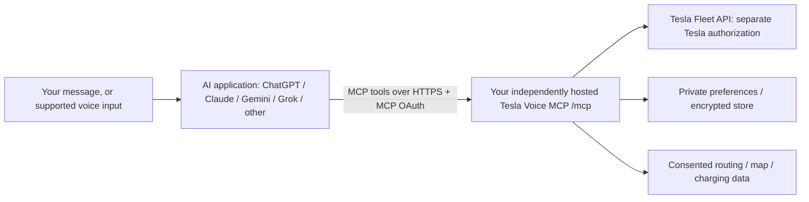

# Connect Tesla Voice MCP to ChatGPT, Claude, Gemini, Grok and other AI clients

**This is not a ChatGPT-only integration.** Tesla Voice MCP exposes a remote, HTTPS, OAuth-protected **Model Context Protocol** server. It is designed to be usable by different AI clients that support the necessary MCP transport, authentication and tool types.

> **Compatibility statement (2026-11-17):** We **expect** Tesla Voice MCP to be compatible with ChatGPT, Claude, Gemini, Grok and other clients **where those products offer custom remote MCP connections with compatible authorization and tool permissions**. These are **expected integration paths, NOT end-to-end-tested integrations with this repository**. Do not claim that a successful MCP login proves read/write features, in-car execution or voice-mode support.

## What gets installed where?



**Important:** You do **not** install the server *inside* Claude or Gemini. You deploy **your own server**, then connect your AI client to `https://<your-hostname>/mcp`. Voice, when available, is implemented by the **AI application**, not this project.

## Quick compatibility matrix

| Client surface | Custom remote MCP capability in vendor documentation | Expected with this server? | Independently tested with this server? | Voice control of MCP tools? |
| --- | --- | --- | --- | --- |
| **ChatGPT** (eligible custom-MCP workspace/web) | Yes; privileges depend on plan/workspace | **Expected, conditional** | **No clean-room client test in this release** | **Do not assume:** OpenAI's current general apps FAQ says Voice mode does not support apps |
| **Claude / Claude Desktop** | Yes; custom remote connectors and OAuth | **Expected, conditional** | **Not tested** | Voice application exists; **connector invocation in voice not attested here** |
| **Claude Code** | Yes; remote MCP configuration | **Expected, conditional** | **Not tested** | Not a turnkey consumer voice assistant |
| **Gemini CLI** | Yes; remote HTTP/SSE MCP and OAuth 2.0 | **Expected, conditional** | **Not tested** | CLI is text-first; voice requires another supported client/interface |
| **Gemini Apps / Spark Connected Apps** | Custom third-party MCP connections available where eligible | **Expected, conditional** | **Not tested** | Gemini Live compatibility with this custom MCP **not tested** |
| **Grok via xAI API** | Remote MCP in SDK/Responses API and Speech-to-Speech API | **Expected, conditional** | **Not tested** | **Developer voice path exists**, but this server's OAuth/tool behavior is not tested |
| **Grok app / custom connectors** | Vendor documents custom MCP connectors on supported product surfaces | **Expected, conditional** | **Not tested** | App-side voice invocation of this server **not tested** |
| **Other AI clients** | Varies | **Potentially**, subject to transport/auth | **Not tested** | Check each surface separately |

**Expected** means a documented client-facing capability exists and the server exposes a relevant MCP surface. It does **not** imply that a vendor has validated Tesla Voice MCP. A different protocol version, OAuth-client registration method, JWT audience or tool permission model may still block connection.

## The four checks that determine compatibility

1. **Remote MCP transport:** Client can reach an HTTPS URL and issue supported MCP requests. This code's `/mcp` endpoint is **POST-based**, not a local `stdio` process, and it is not a general-purpose legacy SSE server. The worker supports a bounded legacy handshake adapter and a newer protocol variant; an arbitrary client is not guaranteed to negotiate either.
2. **MCP-client OAuth:** The server expects a signed **RS256** token with exactly configured issuer, audience `<APP_ORIGIN>/mcp`, allowed `sub` and required scopes. Discovery is advertised at `/.well-known/oauth-protected-resource`. The operator supplies the **separate OAuth issuer**; the project does not automatically register OAuth clients for every vendor.
3. **Tool discovery and schema:** After authentication, the client must discover `tools/list`, receive valid definitions, and invoke `tools/call` with arguments matching `inputSchema`.
4. **Client permissions:** A client or workspace may block write-capable tools even when the server implements them. **Do not turn off authorization or reclassify dangerous tools as read-only to bypass client policy.**

```text
GitHub source repo = source code, not a deployed MCP URL
Your HTTPS /mcp = MCP tool endpoint for the AI client
Your MCP OAuth issuer = permission for the AI client to use /mcp
Tesla Fleet OAuth = permission for your server to access your own Tesla
Optional Google Places key = server-side map data, NEVER an AI-client token
```

## General setup, independent of vendor

1. Follow [Beginner's Guide](BEGINNERS_GUIDE.md) for the offline test first.
2. Deploy your private instance using [Installation](INSTALLATION.md). Complete HTTPS, Redis, two separate OAuth trust boundaries and any Tesla authorization only when ready.
3. Confirm the protected resource URL and that unauthenticated requests are **rejected**, not silently accepted.
4. Keep `vehicle:control` disabled during first integration.
5. In a compatible AI client, choose its **custom remote MCP server/connector** function and supply **your own** `https://<your-hostname>/mcp`.
6. Complete the supported **MCP OAuth** flow; if the client cannot use the configured OAuth issuer/client registration method, stop and diagnose.
7. Discover tools, start with `get_connection_status`, then a read-only or local calculation.
8. Link your own Tesla account with `connect_tesla` **separately and explicitly** if needed.
9. Enable location/charging tools with consent. Enable live commands only after a separate security and vehicle acceptance process.

**First safe prompt:** “Check the MCP connection status without contacting or waking a vehicle; identify which permissions and tools are available.”

**Second safe prompt:** “Estimate energy for a 200 km trip using 60 kWh usable capacity, 16 kWh/100 km, 80% departure and 15% arrival reserve. Do not call Tesla.”

## ChatGPT — supported eligible custom MCP workspaces

1. Check the current [OpenAI custom MCP guide](https://help.openai.com/en/articles/12584461-connecting-custom-mcp-servers-in-chatgpt). Full MCP capabilities require eligible **Business or Enterprise/Edu** workspaces and the necessary admin or delegated permissions; individual plan access may be limited to read/fetch.
2. On the **web** client where you have permission, open **Plugins → Add custom MCP server** (UI naming may change).
3. Enter your HTTPS `/mcp` URL. A GitHub URL or Tesla Fleet URL is **not** the endpoint.
4. Complete MCP OAuth, inspect the tool catalog and verify `get_connection_status`.
5. Use text-based tool calls first; independently verify that your workspace permits any intended write tools.
6. **Voice warning:** OpenAI's [general app FAQ](https://help.openai.com/en/articles/11487775-connectors-in-chatgpt) currently says **Voice mode does not support apps**. Do not advertise hands-free ChatGPT Voice → Tesla MCP as a general, guaranteed product feature. Speech dictation into a tool-capable text chat may be a different interaction path, subject to the app.

## Claude / Claude Desktop

1. Review [Anthropic's custom remote MCP connector guide](https://support.claude.com/en/articles/11175166-get-started-with-custom-connectors-using-remote-mcp).
2. In Claude, locate **Customize → Connectors → Add custom connector** (an organization owner may need to register the connector first).
3. Choose a custom remote/web connector and enter your HTTPS MCP endpoint.
4. Review detected OAuth settings. Select the supported OAuth client identity or configure an OAuth client that your **own issuer** accepts. Do not reuse Tesla client ID/secret for MCP authorization.
5. Authenticate, activate the connector in your conversation, inspect the available tools and test `get_connection_status`.
6. Only after text calls work should you attempt voice. Claude Voice exists, but **using this MCP from a voice conversation is not certified by this project**.

Claude's cloud connects to the server directly, including when using desktop/mobile surfaces; your server must be reachable to that cloud service. Never replace the required MCP OAuth with a globally shared unscoped token.

## Gemini CLI — concrete remote HTTP configuration path

Gemini CLI [documents remote MCP and OAuth 2.0 discovery](https://geminicli.com/docs/tools/mcp-server/). In a supported CLI installation:

```sh
gemini mcp add tesla-voice https://<your-hostname>/mcp --transport http
gemini mcp list
```

Replace the placeholder hostname; the command is **illustrative, not executed in this project audit**. Use the CLI's current [MCP management guide](https://geminicli.com/docs/cli/cli-reference/) for OAuth authentication and `tools/list` discovery, then start with a read-only prompt.

**Do not set `trust: true` merely to avoid confirmation prompts.** The Gemini CLI documentation defines that option as bypassing tool confirmations, which is inappropriate for sensitive vehicle operations.

## Gemini Apps / connected apps

Google documents [custom MCP Connected Apps](https://support.google.com/gemini/answer/17209137) in eligible Gemini Apps/Spark experiences, with availability differing by account, region and surface.

1. Confirm your Gemini account exposes the feature to add a custom app/MCP server.
2. Add your independently hosted remote MCP URL.
3. Complete the vendor-supported OAuth process; some clients require explicit OAuth client credentials where Dynamic Client Registration is unavailable.
4. Verify tool discovery and a read-only call before enabling Tesla authorization.
5. **Gemini Live voice → this MCP remains untested**, even if the custom connected app works in text chat.

## Grok / xAI developer integration

[xAI Remote MCP Tools](https://docs.x.ai/developers/tools/remote-mcp) supports remote URLs with tool allowlists, an optional **Authorization bearer token**, and selected request headers. That makes integration **technically plausible** with this server if the token is valid for its OAuth issuer, audience, operator subject and required scopes.

- Use a managed, **short-lived**, least-privileged token. Do not hardcode it in source or expose it in user conversations.
- Scope tool exposure to read-only names during evaluation; for example `get_connection_status`, `get_battery`, `estimate_trip_energy`.
- Do not assume xAI's documented static Authorization field automatically performs this server's full OAuth login/refresh flow.
- Grok's [Speech-to-Speech API](https://docs.x.ai/developers/model-capabilities/audio/speech-to-speech) documents remote MCP tools for **developer-built voice agents**. That is **not** proof that the consumer Grok app will invoke this particular server by voice.

Grok's supported product surfaces change. Verify current [custom connector instructions](https://docs.x.ai/grok/connectors) for consumer UI access; do not promise a menu or voice action without checking it.

## Other compatible clients

The same conditional logic applies to any remote-MCP-capable assistant or developer framework. Evaluate HTTPS transport, OAuth registration, JWT claims, tool schema/version handling, write-tool approvals and voice capability separately. A local `stdio`-only MCP client will not connect directly to this remote server.

## Minimum acceptance checklist per AI client

- [ ] Can add this **actual private HTTPS MCP URL** with the account/plan used.
- [ ] Successful MCP OAuth with the correct issuer/audience/subject/scopes; no credential pasted into chat.
- [ ] `tools/list` returns the intended read-only tools.
- [ ] `get_connection_status` works without contacting Tesla.
- [ ] `estimate_trip_energy` returns a calculation for supplied synthetic values.
- [ ] The client correctly rejects forbidden write tools and honors independent approvals.
- [ ] Tesla OAuth linking and cached/live readings verified separately, where explicitly authorized.
- [ ] **Voice call to a tool** tested separately on that exact client, app, plan and mode.
- [ ] Any command is independently observed on the vehicle; never inferred from an API receipt.

Until these are demonstrated, the correct label is **EXPECTED / NOT END-TO-END TESTED**. See [Voice Usage](VOICE_USAGE.md), [Compatibility test matrix](COMPATIBILITY_MATRIX.md), [Security](SECURITY_MODEL.md), and [Tool reference](TOOLS_REFERENCE.md).

## Privacy and costs

Every connected AI client is a separate data processor with its own retention, consent, permission and billing behavior. It may receive results including sensitive vehicle and place data. Self-hosting the server does not keep such data out of the AI client's infrastructure. The server is **single-operator-per-instance** and must not be used as a public multi-owner credential broker.
