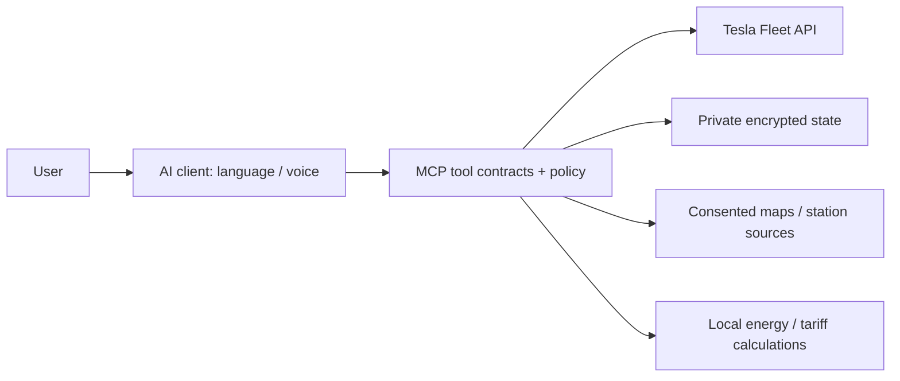

# Architecture, security boundaries and third-party data

## Why MCP instead of a conventional Tesla-only client?

A conventional integration can call Tesla endpoints directly. This implementation separates **conversation (the client)**, **tool contracts and policy (the MCP server)**, **vehicle capability (Fleet API)** and **calculation/provider data (routing, charging and local models)**. The separation allows compatible AI clients to reuse a structured tool surface without embedding vehicle credentials or custom application logic in the assistant itself.



**Architectural boundaries:** MCP is not the intelligence model, Tesla OAuth is not MCP OAuth, a cached reading is not live telemetry, and an API receipt is not physical vehicle evidence. Read [Beyond the Tesla API](WHY_MCP.md) and [Evidence](EVIDENCE.md) for the grounded value proposition and verification vocabulary.


## Component model

```text
Chat or voice client (not provided by this repo)
       |
       | Remote MCP / JSON-RPC, HTTPS, signed MCP access token
       v
simulator/api/mcp.mjs + simulator/worker.mjs
       |
       | Security boundary: JWT validation, scopes, origin and subject
       v
simulator/lib/real-mcp.mjs (tool dispatch and feature gates)
       |                        |
       |                        +--> Local, explicit calculators
       |                             energy, trip, tariff comparisons
       |
       +--> lib/tesla.mjs ------+--> Tesla Fleet API
       |                       +--> api/tesla-command-proxy.go
       |                             signed command transport / receipt journal
       |
       +--> lib/store.mjs --------> Private Redis REST token/history/places store
       |                             server-side encryption
       |
       +--> lib/road-trip.mjs ---> Photon, Nominatim, OSRM / public routing
       +--> lib/google-waypoints.mjs --> Optional Google Places (New)
       +--> lib/european-stations.mjs and national adapters
                                     --> Licensed station datasets / OSM
```

This is a **logical map**, not a deployment proof or a claim that every tool makes all these calls. The feature flags and OAuth permissions determine which branches are reachable.

## Principal files and responsibilities

| Path | Responsibility |
| --- | --- |
| `simulator/api/mcp.mjs` | HTTPS MCP entry, protected simulation and production dispatch selection. |
| `simulator/worker.mjs` | MCP protocol dispatch and input/tool metadata handling. |
| `simulator/lib/real-mcp.mjs` | Assembles the live tool catalog according to read/location/control gates; enforces per-tool OAuth authorization. |
| `simulator/lib/security.mjs` | MCP JWT checks, signed access verification, AES-GCM store encryption and general security parsing. |
| `simulator/lib/tesla.mjs` | Tesla OAuth/token handling, API reads, connection state, command gating and journaling. |
| `simulator/api/tesla-command-proxy.go` | Go transport for signed command execution and selected native navigation operations. |
| `simulator/lib/operation-plans.mjs` | Source of the allowlisted 75 vehicle command operation names, parameters, risk and transport availability. |
| `simulator/lib/road-trip.mjs` | Public map lookup and simple road-route tools. |
| `simulator/lib/smart-trip.mjs` | Natural-language itinerary orchestration and ordered-destination preparation. |
| `simulator/lib/charging-route.mjs` | Road-distance, energy-reserve and bounded DC/HPC stop search. |
| `simulator/lib/google-waypoints.mjs` | Optional Google Places name-to-ID resolution under explicit production gates. |
| `simulator/lib/saved-trip-places.mjs` | Private, user-confirmed Home/Work aliases separate from Tesla favorites. |
| `simulator/lib/charging-preferences.mjs` | Explicit per-account planning preferences and revocable public-map consent. |
| `simulator/lib/european-stations.mjs`, `national-stations.mjs`, `italian-stations.mjs`, `osm-charging.mjs` | National and OSM station discovery normalization. |
| `simulator/lib/public-tariffs.mjs` | Official public Free To X direct-card tariff retrieval, not personal plans. |
| `.github/workflows/tesla-multipoint-ci.yml` | Offline Node, Go and isolated Redis integration checks. |

## Trust boundaries

**AI model and client:** Can see the selected tool arguments/results, including sensitive location if the operator invokes those tools. The client provides the speech interface, tool approvals and any platform-level constraints; the server must never assume all clients behave identically.

**MCP OAuth service:** Issues access tokens for this server. Validation of `iss`, `aud`, `sub`, signature, expiry and tool scopes is mandatory. Tesla OAuth is separate and cannot substitute for MCP authorization. The code is intended for **one configured subject per isolated instance**.

**Tesla Fleet API:** Enforces owner authorization and Tesla-side access requirements. Signed commands and virtual-key pairing have their own prerequisites. Successful transport response must be distinguished from observed change on the vehicle.

**Storage:** Tesla authorization, private places, journal and preferences belong in the private configured Redis-compatible store, using server-side encryption for sensitive records. Credentials, signing material and the encryption key belong exclusively in protected configuration.

**Mapping:** When location/search consent is given, relevant names or coordinates are sent to the chosen public geocoding/routing provider. Optional Google Places sends inputs under its own provider terms, quotas and billing. Self-hosting does not mean data never leaves the operator's infrastructure.

**Telemetry and execution:** Cached data has timestamps and is not necessarily current. Live queries may use Fleet API quota and contact or wake the vehicle. Prepared navigation payloads and `accepted` HTTP responses are not proof of an active route on the display. The GPS multipoint diagnostic is deliberately staged and non-atomic.

## Data sources and legal conditions

| Source | Role | Attribution / restriction |
| --- | --- | --- |
| Tesla Fleet API | Proprietary vehicle data, status, commands and some nearby chargers. | Tesla developer terms, quotas, account authorization and usage billing; no endorsement. |
| OpenStreetMap, Photon, Nominatim, OSRM, Overpass | Public addresses, road graphs, routing and charging-point candidates. | OSM attribution/ODbL and the public server operators' usage policies; not a guaranteed service. |
| Italian PUN / AgID-GSE | Public station snapshots. | Source code expects CC BY 4.0 metadata and attribution. |
| French IRVE / data.gouv.fr | France station inventory. | Source checks accepted license codes and provides publisher attribution. |
| German BNetzA | German charging station registry. | CC BY 4.0 attribution in code. |
| Swiss SFOE / ich-tanke-strom.ch | Swiss station data. | **Non-commercial reuse restriction** documented in source; seek permission before commercial reuse. |
| Free To X | Official public card/POS tariff listing. | Not a personally negotiated contract or guaranteed price at any station. |
| Google Places (optional) | Place-resolution IDs. | Own key, billing, quotas, location data disclosure and Google licensing rules. |

Do not copy restricted source datasets into the public repository or conflate licenses for **code** and **data**. License compatibility and dataset rights for a specific commercial deployment require the operator's own review.

## Operations that must remain explicit

- Creating or reconnecting the Tesla OAuth link.
- Requesting fresh GPS/vehicle status and deciding whether to disclose the query to external maps.
- Changing Home/Work aliases or persistent charging preferences.
- Enabling physical vehicle command capabilities.
- Issuing any live command, including unlock, trunk, climate, charge, signals, navigation or `wake_up`.
- Repeating a command after an uncertain result or changing the planned stop order.

No code in this repository constitutes an open invitation to operate another person's vehicle. See [SECURITY.md](../SECURITY.md).
