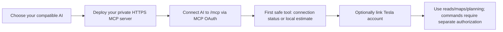
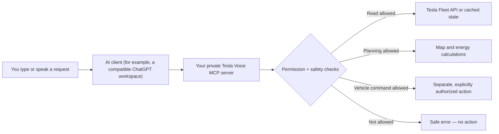

# Beginner's Guide — From Zero to Your First MCP Result

## Your own AI assistant — text or supported voice

**You are not installing a new AI model.** You are giving an existing, compatible AI application a set of authorized tools. Once you have **your own** hosted MCP server, you connect it to your chosen AI client:

| First-time question | Short answer |
| --- | --- |
| “Will it work only in ChatGPT?” | **No.** It is intended for clients such as Claude, Gemini, Grok and others supporting custom remote MCP. Each integration is **expected, conditional and not yet end-to-end tested with this repository**. |
| “Do I paste the GitHub link into Claude?” | **No.** Deploy the server first, then add **your own HTTPS `/mcp` URL**. |
| “Can I just talk to my AI?” | **Only if that specific voice mode can invoke custom MCP tools.** Speech and voice support come from the AI client, not this server; some voice modes cannot use connected apps. |
| “Do I need Google Maps billing?” | **No** for supported OSM-based searches and basic planning. Google Places is optional for some Place-ID/native-waypoint workflows. |
| “Will it operate my car automatically?” | **No.** Vehicle commands need separate permissions, explicit user intent and configured safety gates. |



**Start with text chat.** Then, where officially supported, test voice with a read-only tool. Successful text MCP integration **does not prove voice-mode integration**.

**Next:** [Connect your AI client](AI_CLIENTS.md) · [How voice works](VOICE_USAGE.md) · [Google Places / Place IDs](GOOGLE_PLACES_SETUP.md) · [Map providers](MAP_PROVIDERS.md).

## The easiest way to start

**You do not need a Tesla, credit card or hosting account to try the project safely.** First learn what the software does, download it and run the included offline checks. A fully connected Tesla installation is a separate, advanced phase.

```text
Understand it -> Download source -> Run offline checks -> Stop or choose deployment
                                                       -> Configure OAuth and Tesla
                                                       -> Connect compatible client
                                                       -> Read cached data first
```

**If you only have five minutes:** read [Why this MCP is different](WHY_MCP.md), scan the [guided demonstration](DEMO.md), then follow **steps 2–5 below** to validate a local checkout. Those steps never send an operation to a vehicle.

### Four words you will see often

| Term | Plain-English meaning |
| --- | --- |
| **API** | A defined way for software to request data or an action from another service |
| **MCP tool** | A specific capability an AI client can discover and request, with typed inputs |
| **OAuth** | A controlled authorization process; here the AI client's permission and Tesla's permission are separate |
| **Deploy** | Run your own server on an HTTPS-capable host so a remote client can reach it |

### What will prove you succeeded?

After the offline steps, Node and Go test commands finish with **zero failures**. That establishes a working **local test environment**, not a configured MCP client or connected Tesla. After a real deployment, the first success is **authenticated MCP tool discovery plus a timestamped cached reading (if one is available)**—never an unsolicited vehicle command.


**New here? Start on this page.** No Tesla commands will be sent by following the first part of this guide.

> **Important:** Tesla Voice MCP is a self-hosted developer project, **not a one-click application**. You need to configure your own server, accounts, authentication and private storage before connecting a real car. If you have never deployed a web application or configured OAuth, the full setup will require learning those concepts. The safe offline walkthrough below is suitable for beginners.

## What will you achieve?

| Stage | Result | Requires a Tesla? | Can affect the car? |
| --- | --- | --- | --- |
| 1. Understand | Know what the MCP server does | No | No |
| 2. Download | Obtain a local copy of the source | No | No |
| 3. Offline checks | Verify that the software passes its included tests | No | No |
| 4. Private server | Deploy your own HTTPS endpoint | No | No, if command gates remain disabled |
| 5. Secure connection | Authenticate an MCP-compatible AI client | No | No |
| 6. Tesla account | Authorize your own Tesla account | Yes | Linking alone does not issue a vehicle command |
| 7. First read | Retrieve a cached battery reading | Yes | No implicit wake |
| 8. Advanced features | Optional maps, trips, commands and multipoint | Depends | Some operations can |

**Recommended stopping point:** Complete stages 1–3 first. If they work, continue to the private-server setup.

## 1. Understand the three moving parts



- **AI client:** provides the conversation and, if supported, voice input/output. This repository does not contain a voice app.
- **MCP server:** interprets structured tool calls, validates permissions, stores private settings and applies safety gates.
- **Tesla Fleet API:** Tesla's official integration, requiring an app registration and authorization for your own account.

The MCP server is **not Tesla's mobile app**. Merely downloading the source does not connect a vehicle.

## 2. What you need

### For the safe offline trial

- A computer running macOS, Windows or Linux.
- **Git** (to download the project).
- **Node.js 22 or newer** and **Go 1.23 or newer** (for the included checks).
- A terminal (Terminal on macOS/Linux, PowerShell or a Git-capable terminal on Windows).

You do **not** need a Tesla, API keys, a credit card, a map account or a cloud subscription to run the offline checks.

### For a private connected deployment (later)

- Your own Tesla account and access to the [Tesla Developer / Fleet API documentation](https://developer.tesla.com/docs/fleet-api).
- An HTTPS hosting account supporting the project's Node and Go endpoints (the included configuration targets Vercel).
- A **separate MCP OAuth issuer** that can issue the JWTs expected by the server.
- A private Redis REST-compatible store and encryption key.
- An AI client that supports **remote MCP over HTTPS and the required OAuth flow**.
- Time to configure permissions, callback URLs, billing limits and security.

**Cost warning:** Hosting, Tesla Fleet API traffic, storage and optional Google Places may incur charges. Check each provider's current free allowances and billing terms. There is no guaranteed zero-cost live deployment.

## 3. Download the source

When the repository is public, open its GitHub page and choose **Code → Download ZIP** (simplest), or use Git:

```sh
git clone https://github.com/<owner>/Tesla-Voice-MCP.git
cd Tesla-Voice-MCP
```

Replace `<owner>` with the actual repository owner shown on GitHub. This is a placeholder, not a ready-to-run URL. If the repository is still private, only authorized collaborators can download it.

**Expected result:** you can see `README.md`, `docs/`, `simulator/` and `AGENTS.md` in the downloaded folder.

## 4. Verify your computer is ready

Open a terminal inside the repository folder and run:

```sh
git --version
node --version
go version
```

**Expected result:** each command prints a version. Node must be at least 22 and Go at least 1.23. If the terminal says “command not found” or “not recognized,” install that tool from its official website and reopen the terminal.

If you used **Download ZIP**, Git is not required for the next checks.

## 5. Run the offline checks — no vehicle access

From the **repository root**, run the following commands one at a time:

```sh
node simulator/prepare-artifact.mjs
```

**Expected result:** the command completes and prepares a local, ignored `simulator/dist/` artifact. It does not deploy or connect to Tesla.

Then run:

```sh
node --test simulator/*.test.mjs
```

**Expected result:** Node reports test totals and **zero failures**. Exact test counts can change between versions. Tests use synthetic fixtures; some integration checks may require a separate disposable test Redis instance. Never point tests at your real Tesla account or production Redis.

Finally, check the Go components:

```sh
cd simulator
go test ./...
go build ./...
go vet ./...
cd ..
```

**Expected result:** all commands exit successfully. The first Go run may download public dependencies. If any step fails, stop here and use [Troubleshooting](TROUBLESHOOTING.md); do not compensate by adding Tesla secrets.

### Your first checkpoint

- [ ] Source downloaded.
- [ ] Node and Go versions meet requirements.
- [ ] Local artifact prepared.
- [ ] Node tests completed without failures.
- [ ] Go tests, build and vet completed without failures.

**You have now tested the source offline. You have not installed a connected Tesla service.** That is a successful and safe first milestone.

## Optional first-install simulation — one command

After cloning the repository, try a clean, independent **MCP request smoke test**:

```sh
node --test simulator/clean-room-install.test.mjs
```

**Expected:** one passing test and no Tesla/Google/hosting account required. The test generates a short-lived synthetic RSA key, starts a localhost-only HTTP adapter to the actual MCP handler, verifies OAuth access and returns an invented battery percentage. It **does not** deploy a server or prove a real Tesla integration. For the exact checks, see [Clean-room installation simulation](CLEAN_ROOM_SMOKE.md).

## 6. Decide whether to connect a real Tesla

If your goal is only to learn or contribute, **stop after step 5**. You can review the [Guided Demo](DEMO.md) and [Tool Reference](TOOLS_REFERENCE.md) without spending money or connecting a vehicle.

If you want live functionality, continue with the following **operator checklist**. It is intentionally not a one-click recipe: the external OAuth and Tesla registration steps require your own provider accounts and must be completed correctly.

## 7. Create your private HTTPS server

1. Create your own hosting project (the supplied deployment configuration targets **Vercel**).
2. Import your fork or private copy of the repository.
3. Set the hosting project's **Root Directory to `simulator`**.
4. Configure your intended HTTPS hostname.
5. In the host's **private environment-variable settings**, set `APP_ORIGIN` to that exact HTTPS origin (without a trailing slash).
6. Leave vehicle-command execution **disabled**.
7. Review `simulator/vercel.json` and [Configuration](CONFIGURATION.md) before deploying.
8. Deploy only after the required environment settings are ready.

**Do not paste credentials into GitHub files, a README, an issue, a chat message or a public screenshot.**

The remote MCP endpoint will be:

```text
https://<your-hostname>/mcp
```

Your host name is private to your deployment. The example is not a working public service.

**Checkpoint:** HTTPS responds, the deployment logs show no startup errors, and the MCP endpoint does not grant anonymous access. A protected endpoint may correctly return an authorization error to an unauthenticated browser request; that is not proof of failure.

## 8. Set up two different kinds of authorization

This is the most common source of confusion.

| Authentication | Who is being authorized? | Purpose |
| --- | --- | --- |
| **MCP OAuth** | Your AI client | Allows it to invoke specific MCP tools |
| **Tesla OAuth** | Your Tesla account | Allows your server to access Tesla Fleet API resources |

You need **both** for live Tesla data. They are **not interchangeable**.

### MCP OAuth (client → your server)

Use your own OAuth issuer capable of providing **RS256** JWTs. The server checks the issuer, public keys (JWKS), exact resource audience, allowed subject and required scopes. Configure the private environment values `MCP_AUTH_ISSUER`, `MCP_AUTH_JWKS` and `MCP_ALLOWED_SUBJECT`.

**Expected result:** a correctly authenticated client can discover allowed tools; an unauthenticated client is rejected. Never disable authentication to work around a connection error.

### Tesla OAuth (your server → Tesla)

Register **your own** application using Tesla's official documentation. Configure the callback URL for your hostname:

```text
https://<your-hostname>/oauth/tesla/callback
```

Set the required Tesla app and region variables privately. Use the smallest Fleet API permissions needed for your use case. Pairing a virtual key for signed commands is a **separate advanced step**; you do not need to enable vehicle commands to begin with cached reads.

**Checkpoint:** the MCP client and Tesla account are separately connected. A valid MCP login alone does not prove Tesla linking is complete.

For the exact variable list, follow [Complete Installation](INSTALLATION.md) and [Configuration](CONFIGURATION.md). The file `simulator/.env.example` lists names only; **do not fill it with real secrets and commit it**.

## 9. Connect a compatible AI client

Choose your supported platform and follow [AI Clients](AI_CLIENTS.md), then consult [Voice Usage](VOICE_USAGE.md) if you intend to speak to the assistant. The first successful test is a **text-based, read-only tool call**, not a vehicle command.


1. Confirm your client supports a **custom remote HTTPS MCP server** and its OAuth flow.
2. Add your own `https://<your-hostname>/mcp` URL through the client's current MCP configuration interface.
3. Complete **MCP OAuth**, review requested permissions and inspect the available tools.
4. Ask the client: **“Check my MCP connection status without contacting the car.”**
5. If not linked, explicitly request the `connect_tesla` flow and complete Tesla authorization.
6. Ask: **“Read my cached battery level and tell me when it was measured. Do not wake the car.”**

**Expected result:** a connection status and, when available, a timestamped cached battery reading. If no cached reading exists, the correct response is **“no cached data available,” not a made-up percentage**.

Client interfaces and eligibility change. Follow [Client Setup](CLIENT_SETUP.md); do not assume a particular ChatGPT plan automatically supports custom remote MCP.

## 10. Explore safely, one feature at a time

| Say this to the AI client | Typical capability | Safety note |
| --- | --- | --- |
| “Show the available vehicle commands; do not execute any.” | Command catalog | Read-only |
| “Estimate a 100 km drive using the battery assumptions I provide.” | Energy estimate | Calculation, not a Tesla read |
| “Search for a destination, but ask if the result is ambiguous.” | Map lookup | Requires consent to share the query |
| “Prepare an itinerary with three stops; do not send it.” | Smart trip | Preparation only |
| “Prepare 16 ordered destinations, without sending anything.” | Navigation-only planner | Offline-tested; actual display support remains experimental |

**Do not start with unlock, remote start, climate, trunk or navigation dispatch.** Vehicle controls require separate explicit intent, scopes, gates, and sometimes Tesla virtual-key pairing.

## 11. Troubleshooting in plain English

| What you see | What it usually means | What to do |
| --- | --- | --- |
| `node: command not found` | Node is not installed or on PATH | Install Node 22+ and reopen the terminal |
| `go: command not found` | Go is not installed or on PATH | Install Go 1.23+ and reopen the terminal |
| Tests fail | Version mismatch or test dependency | Check the failing test; do not add production secrets |
| Server returns 401 | Missing or invalid MCP OAuth | Check issuer, audience, subject, signature and expiry |
| Client cannot add MCP server | Unsupported client/plan/transport | Check the client's current remote MCP support |
| Tesla is not connected | Tesla OAuth incomplete | Use `connect_tesla` explicitly |
| Tool is unavailable | Permission or feature gate is missing | Inspect `tools/list` and the deployment configuration |
| Battery reading looks old | It is cached | Check timestamp; request a live read only when intended |
| Place cannot be resolved | Provider returned no result or ambiguity | Clarify the place; do not guess |
| 16 stops were accepted but not displayed | API receipt is not vehicle verification | Inspect the car; do not blindly retry |

For deeper diagnosis, see [Troubleshooting](TROUBLESHOOTING.md).

## 12. What you should never do

- Never publish Tesla credentials, refresh tokens, signing keys, Redis tokens, VINs or private addresses.
- Never use the original maintainer's account, OAuth client, vehicle or infrastructure.
- Never turn on every feature gate just to make an error disappear.
- Never use production Redis or a real Tesla account for automated tests.
- Never assume a successful API response proves that the car performed an action.
- Never automatically wake the vehicle or repeat a command whose outcome is unknown.
- Never assume Google Places is required; OSM-based discovery is supported.
- Never assume live usage is free; review provider costs and limits.

## Next reading — only when you need it

- [Guided demonstration](DEMO.md) — see fictional example conversations and tool results.
- [Complete installation](INSTALLATION.md) — detailed operator requirements and environment settings.
- [Client setup](CLIENT_SETUP.md) — remote MCP and OAuth compatibility.
- [Tool reference](TOOLS_REFERENCE.md) — what each MCP tool does.
- [Customization](CUSTOMIZATION.md) — private destinations, charging assumptions and map providers.
- [Security model](SECURITY_MODEL.md) — trust boundaries and command safeguards.

---

**Final expectation:** A beginner can complete the offline trial with the steps above. A fully connected Tesla deployment is an **advanced integration** and should be considered successful only after the operator independently validates HTTPS, OAuth, Tesla linking and the intended read-only tools. This guide has not been independently tested by a first-time external installer.
