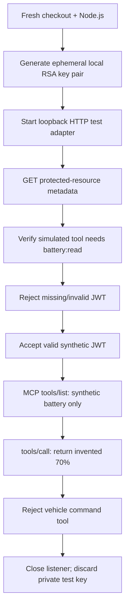

# Clean-room installation simulation — repeatable, credential-free smoke test

**Goal:** determine whether a new checkout of this repository can start a minimal MCP endpoint and answer a synthetic tool request **without** reusing any existing operator's Tesla, Google, Redis, OAuth or hosting resources.

**Status:** **VERIFIED_OFFLINE** for the isolated test harness introduced with `simulator/clean-room-install.test.mjs`. The [GitHub Actions run](https://github.com/VladTepes84/Tesla-Voice-MCP/actions/runs/44103169174) on commit `e2a77c8` passed **537 Node tests**, Go test/build/vet and isolated Redis integration. Gitleaks also passed on the [same candidate](https://github.com/VladTepes84/Tesla-Voice-MCP/actions/runs/44103169101), scanning 11 commits with no detected leaks.

> This is a *first-install simulation*, **not** a Vercel cloud deployment, a real Tesla authorization test, an actual Google Places request, a ChatGPT/Claude/Gemini/Grok connector handshake or a live vehicle test. No external account was registered and no provider was billed. No command reached any car.

## One command to try the isolated MCP instance

Prerequisites: a clean repository checkout and **Node.js 22+**. From the repository root:

```sh
node --test simulator/clean-room-install.test.mjs
```

**Expected result:** one passing test, zero failures. The process opens a short-lived HTTP listener bound to `127.0.0.1`, calls the **actual MCP and OAuth-resource handlers** using a synthetic HTTPS origin, then closes the listener and restores the environment.

**You do not need**:
- a Tesla or Tesla developer account;
- any Tesla VIN, access token, private key or vehicle authorization;
- a Google Maps Platform account or Places API key;
- Vercel, Auth0 or Redis;
- a subscription to ChatGPT or another AI app.

The test **never** intentionally calls Tesla, Google, external maps, registration, signed-command endpoints or production secrets.

## Exactly what the simulation checks



| Check | Expected condition |
| --- | --- |
| Protected resource discovery | Correct simulated MCP resource and OAuth issuer |
| Required scope | Advertises `battery:read` for the synthetic battery tool |
| No bearer token | HTTP 401 |
| Wrong resource audience | HTTP 401 |
| Wrong allowed operator subject | HTTP 401 |
| Missing read scope | HTTP 401 |
| Expired token | HTTP 401 |
| Valid local JWT | Authenticated `tools/list` |
| Available tool surface | **Only `get_simulated_battery`** in this production-mode simulated instance |
| Tool response | `source: "SIMULATED"`, invented `battery_percent: 70` |
| Live command request | Rejected as unavailable |
| External Tesla/Google/Redis connection | **None required or authorized** |

The test issues a normal local HTTP request to a loopback adapter, not HTTPS to a remote host. It deliberately simulates the deployment platform's request handling rather than making users install TLS certificates or provision cloud resources for a synthetic check.

## Defect discovered and corrected during this simulation

The first run **failed**: when all real Tesla feature gates were disabled, the OAuth protected-resource metadata advertised `tesla:connect` but omitted the `battery:read` scope needed by the available synthetic battery tool.

A minimal correction was made in `simulator/api/protected-resource.mjs`:
- a **production simulated-only** instance now advertises `battery:read`;
- Preview continues to advertise its simulated read/map scopes;
- real Tesla configurations continue to advertise their separately enabled read, location and control scopes;
- the change does **not** enable Tesla, wake a car, bypass MCP OAuth or grant command execution.

The regression test then passed on commit `e2a77c8`. This is evidence that the new smoke test caught a real onboarding inconsistency rather than merely re-running existing mocks.

## Next: what a new operator still must configure for real use

1. [Private HTTPS deployment](INSTALLATION.md), including the `simulator/` root in the supplied Vercel setup.
2. [MCP OAuth issuer/JWKS and authorized subject](CONFIGURATION.md), separate from Tesla OAuth.
3. Private Redis REST storage and encryption-key management.
4. Own [Tesla Fleet developer app and authorization](https://developer.tesla.com/docs/fleet-api/), including any needed partner registration and virtual-key pairing for signed commands.
5. A client that supports [this exact remote MCP/OAuth model](AI_CLIENTS.md), with eligible tool permissions.
6. Optional [Google Places API (New)](GOOGLE_PLACES_SETUP.md) and [maps](MAP_PROVIDERS.md) consent/quotas.
7. Read-only acceptance on the *operator's own* installation, then a separate safety review for physical commands.
8. Independent physical display verification before claiming multi-stop navigation works on the vehicle.

**Important:** “I entered my Tesla API credentials and Google Places key” does not establish a working MCP connection. The server also needs the correct OAuth resource, compatible client, storage and Fleet account setup. Voice operation is additionally client/mode-dependent.

## Release gate

This smoke test provides repeatable **offline** evidence and protects against a class of onboarding regression. It does **not** satisfy every box in [Public-release checklist](PUBLICATION_CHECKLIST.md). In particular, independently configured external provider credentials, genuine client OAuth compatibility, provider/data licenses, any credential-exposure remediation and an end-to-end first-time installation still require separate evidence.

**Release decision:** Do not make the repository public on the strength of this simulated test alone.
