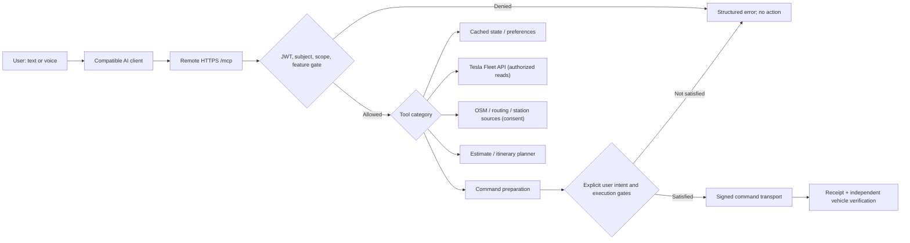
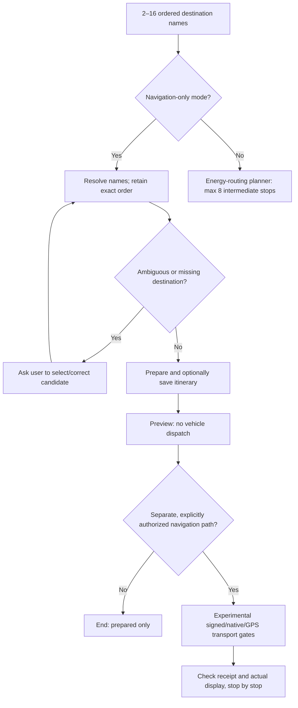

# Tesla Voice MCP — Guided product demonstration

## What makes these examples valuable?

Each demonstration shows **which additional logic the server contributes on top of Tesla Fleet API**: source timestamps, local calculations, external data joins, authorization decisions and the difference between prepared, accepted and verified operations.

They are **static Markdown examples**, not a running interactive simulator or a recording from an actual vehicle. For a cross-cutting comparison, read [Beyond the Tesla API](WHY_MCP.md); for professional end-to-end flows, read [Practical workflows](WORKFLOWS.md).


> **Synthetic demonstration.** Every name, address, timestamp, vehicle reading, price and response below is illustrative, not a recording of a Tesla session. This page never calls an API or a vehicle. Tool names refer to implemented MCP capabilities; actual availability depends on OAuth scopes, feature gates and provider connectivity.

## What the project does

A compatible AI client turns natural-language intent into **typed MCP tool calls**. The server authenticates the caller, applies scope and runtime gates, then performs a bounded read, a calculation, a map lookup or a separately authorized vehicle operation. It is **not** a standalone speech application: voice input/output belongs to the client.



## Demo 1 — Battery information without waking the car

**User:** “What is the battery level, and when was that reading taken?”

**Typical tool sequence:** `get_connection_status` → `get_battery`.

**Illustrative response:**
```json
{
  "demo_only": true,
  "battery_percent": 62,
  "data_timestamp": "2030-01-15T09:30:00Z",
  "reading_type": "cached",
  "vehicle_contacted": false,
  "wake_up_performed": false
}
```

**Expected assistant behavior:** “The last cached reading is 62% as of 09:30 UTC. This is not a live measurement.” Do not silently call `get_live_vehicle_data`; that is a separate, potentially metered operation.

## Demo 2 — One deliberately requested live read

**User:** “Please refresh the vehicle data now.”

**Typical tool:** `get_live_vehicle_data` (requires the relevant read permission and a connected Tesla account).

**Illustrative outcome:** live state with source timestamp, or a clearly surfaced provider/vehicle error. This call **may contact or wake the car**, uses quota, and does not automatically retry or substitute stale cached data on failure.

## Demo 3 — Estimate a trip and reserve

**User:** “Estimate a 230 km drive with a 15% arrival reserve. Use the battery and consumption values I provide.”

**Typical tools:** `estimate_trip_energy`, optionally `plan_trip` or `plan_road_trip`.

```text
Inputs: distance + usable capacity + consumption + departure SOC + target reserve
  -> estimated kWh required
  -> estimated arrival SOC
  -> reserve margin or deficit
  -> warnings about assumptions, weather, terrain and routing
```

No Tesla command is sent. An energy estimate is not Tesla's native range prediction.

## Demo 4 — Find charging options and compare costs

**User:** “Find CCS2 DC chargers along my planned route, then compare two tariffs I provide.”

**Typical tools:** `plan_charging_road_trip` → `find_charging_sites` (when a local-area search is useful) → `compare_charging_costs`.

**Example comparison (illustrative only):**

| Option | Variable price | Session fee | 30 kWh cost before charging losses |
| --- | ---: | ---: | ---: |
| Tariff A | €0.40/kWh | €0.00 | €12.00 |
| Tariff B | €0.32/kWh | €3.00 | €12.60 |

The cost tool uses caller-provided tariffs. Public station records do not prove live availability, exact pricing or payment-method eligibility. AC charging can be discovered locally but is not inserted as an automatic DC/HPC corridor stop.

## Demo 5 — Resolve an ambiguous destination safely

**User:** “Find Central Library.”

**Typical tool:** `search_trip_destination` (after map consent).

**Illustrative assistant response:** “I found multiple candidates. Which city and entrance do you want?” The assistant should **not** silently select an ambiguous result or send navigation. A public geocoder can receive the search query; review the consent boundary.

## Demo 6 — Build a 16-destination route without claiming it reached the car

**User:** “Prepare these 16 destinations in the order I give you, and keep the final destination explicit.”

**Typical tools:** `plan_smart_trip` → optional `resolve_waypoint_places` (Google Places enabled, consented, and billed by the operator) or OSM/Photon resolution → `get_planned_trip`.



**Acceptance matrix:**

| Claim | Evidence needed |
| --- | --- |
| 16 destinations accepted by planner | Offline test for 16 names and order |
| Place names resolved | Provider response and user validation of ambiguous places |
| Payload prepared | Serialized payload and schema validation |
| Tesla API accepted request | Actual authenticated provider response |
| All 16 stops visible in order | **Independent physical inspection of the in-car navigation display** |

A `tesla_accepted` flag is **not** proof of the final row. Never “repair” a failed multi-stop route by silently sending 16 individual single-destination commands: they may overwrite one another.

## Demo 7 — Prepare and execute a vehicle command safely

**User:** “What commands are available?” → `get_vehicle_command_catalog` (read-only catalog).

**User:** “Prepare a lock command.” → `prepare_vehicle_command` (stages an allowed command; no dispatch).

**User:** explicitly confirms the staged operation → `execute_vehicle_command`, subject to its confirmation protocol, scopes, pairing, gates and client approval. An explicitly requested direct operation may instead use `execute_requested_vehicle_command` with its own authorization checks.

```text
request -> allowlist + parameter validation -> scope/feature gate
        -> staged ticket or guarded direct invocation
        -> signed transport -> server-side receipt
        -> independent vehicle-state verification
```

Do not treat the server receipt as proof of a lock changing physically. If the outcome is uncertain, inspect status and vehicle state; do not blindly repeat the command.

## Demo 8 — Investigate a failed operation

**User:** “The command was accepted, but nothing changed on the display.”

**Typical tool:** `get_vehicle_command_status` using the known command reference; for experimental GPS diagnostics, use the dedicated phase A/B tools **only with explicit separate requests and physical observation**.

The assistant must distinguish `prepared`, `dispatched`, `accepted`, `rejected`, `unknown` and `observed on vehicle` as different states. Do not invent a success state or run an automatic retry.

## Demo rules for contributors

- Use fictional places, example domains and mock identifiers only.
- No real VINs, personal addresses, coordinates, tokens, private charging contracts or provider keys.
- Never publish screenshots of a real account, navigation history or token-bearing headers.
- Never imply that a sample transcript was recorded live.
- The 16-stop transport is **experimental until independently verified on an actual vehicle**.

Next: [Tool reference](TOOLS_REFERENCE.md) · [Installation](INSTALLATION.md) · [Customization](CUSTOMIZATION.md) · [Security model](SECURITY_MODEL.md).
