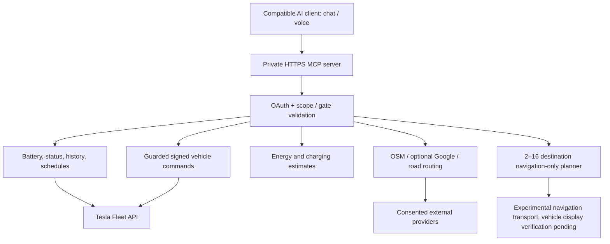

# Documentation hub

**Tesla Voice MCP — comprehensive English-language operator and developer manual.** All examples are synthetic and contain no real account, vehicle, credential, private address or location data. The source is a self-hosted remote MCP implementation, not a public hosted service.

## Choose your path

| You want to... | Start here | Then read |
| --- | --- | --- |
| **First time here?** | **[Beginner's guide — start from zero](BEGINNERS_GUIDE.md)** | [Guided demonstration](DEMO.md) |
| Understand the project's capabilities | [Guided demonstration](DEMO.md) | [Feature catalog](FEATURES.md) |
| Review every MCP tool and vehicle command group | [Complete tool reference](TOOLS_REFERENCE.md) | [Live catalog behavior](FEATURES.md#5-remote-tesla-commands) |
| Install without controlling a real car | [Installation: Profile A](INSTALLATION.md#choose-an-installation-profile) | [Getting started](GETTING_STARTED.md) |
| Deploy your own read-only MCP | [Installation](INSTALLATION.md) | [Configuration](CONFIGURATION.md) |
| Connect an AI client | [Client setup](CLIENT_SETUP.md) | [Client compatibility](CLIENT_COMPATIBILITY.md) |
| Personalize maps, saved places and energy assumptions | [Customization](CUSTOMIZATION.md) | [Configuration](CONFIGURATION.md) |
| Understand authorization and data protection | [Security model](SECURITY_MODEL.md) | [Security policy](../SECURITY.md) |
| Diagnose a failed tool, OAuth flow or navigation | [Troubleshooting](TROUBLESHOOTING.md) | [Architecture](ARCHITECTURE.md) |
| Audit release readiness | [Publication checklist](PUBLICATION_CHECKLIST.md) | [Security model](SECURITY_MODEL.md) |
| Contribute to the project | [Contributing](../CONTRIBUTING.md) | [Architecture](ARCHITECTURE.md) |

## Capability overview

## Status vocabulary

- **Implemented:** a tool or transport exists in source.
- **Gated:** requires specific server settings, OAuth scopes, provider permissions or vehicle pairing.
- **Estimated:** a calculation using explicit assumptions; not live telemetry.
- **Experimental:** not proven to work across vehicles/firmware; independent validation required.
- **Verified offline:** automated unit/integration test evidence only.
- **Verified on vehicle:** independently observed physical or in-car result, with the test scope stated.

A successful `tools/call` response or Tesla API acknowledgment **never automatically proves physical vehicle execution**.

## Non-goals and limits

The repository does not provide a built-in speech engine, standalone iOS app, a universal charging-price feed, automatic background polling, shared multi-user SaaS, universal Tesla compatibility or a guaranteed native 16-stop route. Google Places is optional; operator-managed provider costs and terms apply.

For installation, use the **English documentation only**. Never commit credentials, personal routes, VINs, private tariff contracts or real GPS data.
