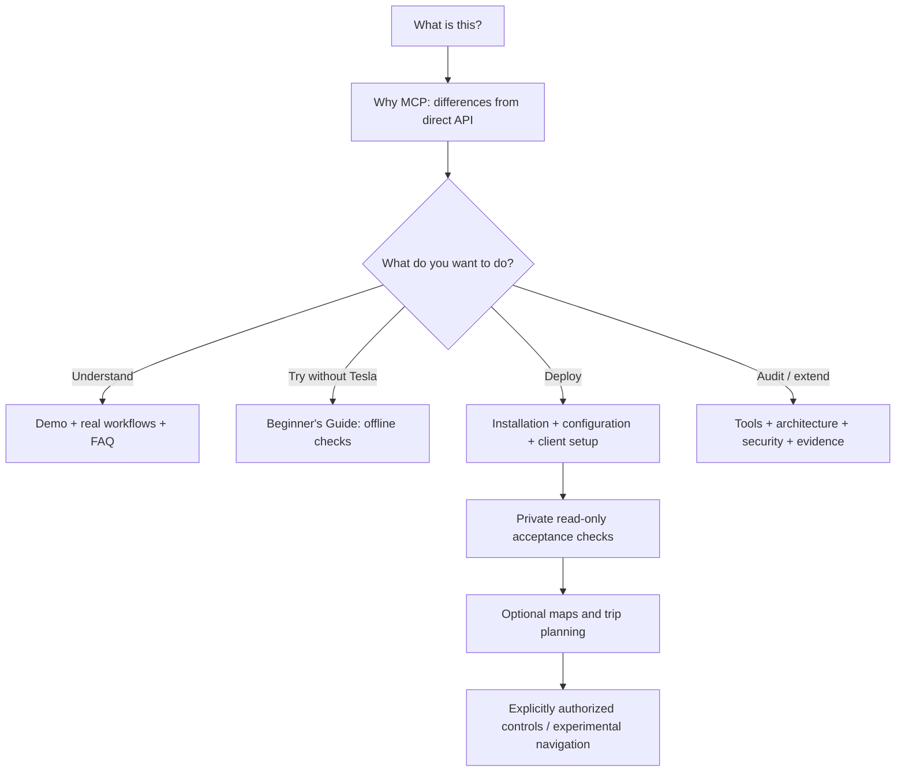

# Tesla Voice MCP — Documentation center

**Choose your role. Follow the shortest path to a verifiable result.** All material is in English. All sample values, destinations and transcripts are synthetic.

## Start by audience

| I am... | Read first | Then follow |
| --- | --- | --- |
| **A complete beginner** | **[Beginner's Guide](BEGINNERS_GUIDE.md)** | [FAQ](FAQ.md) → [Guided demo](DEMO.md) |
| **Want to use another AI or voice?** | **[AI clients: ChatGPT / Claude / Gemini / Grok](AI_CLIENTS.md)** | [Voice limitations](VOICE_USAGE.md) → [Compatibility matrix](COMPATIBILITY_MATRIX.md) |
| **Need maps or Google Place IDs?** | **[Maps and providers](MAP_PROVIDERS.md)** | [Google Places setup](GOOGLE_PLACES_SETUP.md) |
| **A Tesla owner assessing value** | **[Beyond the Tesla API](WHY_MCP.md)** | [Practical workflows](WORKFLOWS.md) → [Feature catalog](FEATURES.md) |
| **An experienced installer** | **[Complete installation](INSTALLATION.md)** | [Configuration](CONFIGURATION.md) → [Client setup](CLIENT_SETUP.md) |
| **A security reviewer** | **[Security model](SECURITY_MODEL.md)** | [Architecture](ARCHITECTURE.md) → [Evidence](EVIDENCE.md) |
| **An engineer or maintainer** | **[Tool reference](TOOLS_REFERENCE.md)** | [Operator runbook](OPERATOR_RUNBOOK.md) → [Contributing](../CONTRIBUTING.md) |

## Guided learning path

## Complete manual

### Understand the product

| Document | Contents |
| --- | --- |
| [Beyond the Tesla API](WHY_MCP.md) | Architecture value, concrete differentiators, honest comparison to direct Fleet API and custom REST development |
| [Guided product demo](DEMO.md) | Eight synthetic use-case demonstrations with tool flow and expected results |
| [Practical workflows](WORKFLOWS.md) | Battery, energy, charging economics, geocoding, 16-stop planning, commands and recovery |
| [FAQ](FAQ.md) | Plain-English answers, pricing/requirements, compatibility and limitations |
| [Feature catalog](FEATURES.md) | Source-backed overview of supported tool families and command groups |

### Install and personalize

| Document | Contents |
| --- | --- |
| [Beginner's Guide](BEGINNERS_GUIDE.md) | Safe zero-to-offline-test walkthrough and staged setup checkpoints |
| [Complete installation](INSTALLATION.md) | Prerequisites, accounts, Vercel root, OAuth, encrypted storage, rollout and acceptance |
| [Getting started](GETTING_STARTED.md) | Condensed operator checklist and acceptance milestones |
| [Configuration](CONFIGURATION.md) | Environment variables, provider setup, private destinations and gates |
| [Client setup](CLIENT_SETUP.md) | Remote MCP, ChatGPT when eligible, OAuth, safe first prompts |
| [Client compatibility](CLIENT_COMPATIBILITY.md) | Plan/workspace/client restrictions and official current guidance |
| [Customization](CUSTOMIZATION.md) | OSM/optional Google, places, preferences, stations and energy assumptions |
| [Troubleshooting](TROUBLESHOOTING.md) | Decision tree, error causes and sanitized support bundle |

### AI clients, voice and maps

| Document | Contents |
| --- | --- |
| **[Connect ChatGPT, Claude, Gemini, Grok and other AI clients](AI_CLIENTS.md)** | Expected remote MCP compatibility, client-specific onboarding, OAuth and read-only smoke tests |
| **[Voice usage and limitations](VOICE_USAGE.md)** | What speech → MCP tool calls require; examples, safe prompts and platform-specific limitations |
| **[Compatibility and verification matrix](COMPATIBILITY_MATRIX.md)** | Vendor support vs actual test results; no automatic claims of real-world compatibility |
| **[Google Places API (New) and Place ID setup](GOOGLE_PLACES_SETUP.md)** | From Google project/billing/key to `resolve_waypoint_places`, disambiguation and safe verification |
| **[Maps and charging-data providers](MAP_PROVIDERS.md)** | Photon/OSM/Nominatim/OSRM, optional Google, national charging datasets, consent and pricing boundaries |

### Build, audit and operate

| Document | Contents |
| --- | --- |
| [Complete tool reference](TOOLS_REFERENCE.md) | 38 MCP tools, scopes, 75 command catalog, status/error semantics |
| [Architecture](ARCHITECTURE.md) | Modules, trust boundaries, API/data sources, licensing and provenance |
| [Security model](SECURITY_MODEL.md) | Threats, token isolation, user intent, vehicle-command lifecycle and incident constraints |
| [Operator runbook](OPERATOR_RUNBOOK.md) | Preflight, private deployment, monitoring, recovery, provider costs and go/no-go |
| [Evidence and readiness](EVIDENCE.md) | Source vs mock vs provider accepted vs independently car-verified |
| [Security policy](../SECURITY.md) | Private vulnerability reporting and deployment responsibilities |
| [Contributing](../CONTRIBUTING.md) | Repository practices, tests and safe contribution requirements |
| [Public-release checklist](PUBLICATION_CHECKLIST.md) | Mandatory release gates; no automatic approval or visibility change |

## What is currently supported, and what is not?

- **Tool inventory:** 38 named MCP tools in the source-backed catalog; dynamic visibility depends on scopes and feature gates.
- **Commands:** 75 operation names in code; eight default SDK transports unavailable in the pinned proxy, with some experimental exceptions. Not a promise of 75 working features on every car.
- **Navigation:** 2–16 ordered **navigation-only** destinations accepted by the planner; separate energy-routing mode has a maximum of eight intermediate stops. Native/GPS multipoint delivery is experimental, **not independently verified as a complete on-screen route**.
- **AI and voice:** provided by the **client**; this repository does not ship a standalone speech engine.
- **Data and cost:** cached readings may be old; route/charging costs are estimates; Tesla and other providers may meter usage.
- **Tenant model:** one authorized operator per isolated deployment; not a shared public SaaS.

## Proof terminology

`IMPLEMENTED` (exists in code) → `VERIFIED_OFFLINE` (mock/isolation tests) → `PROVIDER_ACCEPTED` (real service acknowledged) → `VEHICLE_VERIFIED` (independent physical observation). Each has a different evidence requirement. See [Evidence](EVIDENCE.md).

## First actions

**Just exploring?** Start with [Beginner's Guide](BEGINNERS_GUIDE.md) or [Guided demo](DEMO.md). No Tesla credentials required for the offline stage.

**Ready to integrate?** Begin with [Complete installation](INSTALLATION.md); do not paste credentials into a chat or tracked file.

**Evaluating the design?** Start with [Beyond the Tesla API](WHY_MCP.md), [Tools](TOOLS_REFERENCE.md) and [Architecture](ARCHITECTURE.md).
