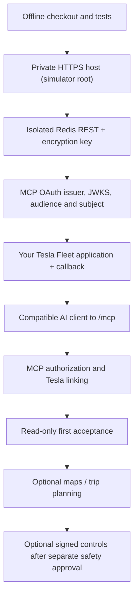

# Complete installation and operator onboarding

## Installation in one diagram



**How to use this guide:** If you are new to the terminology, start with [Beginner's Guide](BEGINNERS_GUIDE.md). For operational monitoring, rollback and incidents, use [Operator runbook](OPERATOR_RUNBOOK.md). No step automatically grants permission to operate a Tesla.

**Stop conditions:** If you cannot configure an isolated Redis store, secure MCP OAuth issuer, exact HTTPS origin or Tesla application safely, **do not enable live vehicle control**. An incomplete setup is preferable to bypassing authentication or publishing credentials.


This is an **advanced, self-hosted remote MCP server**, not a downloadable mobile application, shared hosted Tesla account or one-click ChatGPT plugin. An operator needs their own Tesla Fleet API authorization, HTTPS hosting, OAuth issuer for the MCP client, isolated Redis REST storage, and a compatible client. Do **not** copy the maintainer's deployment or any real credential.

## Before selecting a hosting profile: what are you connecting?

Tesla Voice MCP is **one server for multiple possible AI clients**—ChatGPT, Claude, Gemini, Grok and others—**where remote MCP, OAuth, tool permissions and supported protocol versions align**. Vendor MCP support makes compatibility **plausible, not end-to-end verified** for this exact server. Start in text chat; voice requires separate client support.

Read [AI client-specific setup](AI_CLIENTS.md) and [Voice usage](VOICE_USAGE.md). Map integration is built in at the backend level; optional Google Place IDs have a separate [configuration guide](GOOGLE_PLACES_SETUP.md). OpenStreetMap-based features do not require Google billing.

## Choose an installation profile

| Profile | What you can validate | Dependencies |
| --- | --- | --- |
| A. Offline evaluation | Build, unit tests, synthetic demos, tool contracts | Node.js 22+, Go 1.23+; no Tesla credentials |
| B. Private read-only instance | OAuth discovery, cached readings, explicitly requested Tesla reads | Profile A + HTTPS + Tesla app + MCP OAuth + encrypted Redis |
| C. Maps and energy planning | Geocoding, route estimates, charging discovery, private preferences | Profile B + explicit map consent; optional provider keys |
| D. Vehicle commands | Prepared and explicitly authorized signed commands | Profile B + Tesla partner/virtual-key requirements + control scopes and gates |
| E. Experimental multipoint | 2–16 navigation-only preparation and separately gated transport | Profile D + verified waypoint resolution + independent in-car validation |

Start at **A**, then **B**. Do not enable vehicle controls just to verify deployment.

## 1. Obtain the source and inspect the prerequisites

```sh
git clone https://github.com/<your-fork-or-upstream>/Tesla-Voice-MCP.git
cd Tesla-Voice-MCP
node --version
go version
```

Use the upstream URL appropriate to the public release when available; the placeholder is not a working clone URL. The included Vercel configuration expects the **`simulator/` directory as the project root**, not the repository root.

Read [SECURITY.md](../SECURITY.md), [CONFIGURATION.md](CONFIGURATION.md), [CLIENT_COMPATIBILITY.md](CLIENT_COMPATIBILITY.md) and the environment-variable template before enabling any live operation.

## 2. Run local, offline checks

```sh
node simulator/prepare-artifact.mjs
node --test simulator/*.test.mjs
(cd simulator && go test ./... && go build ./... && go vet ./...)
```

The preparation command writes an ignored local artifact. These commands are **not a deploy**, and most tests use synthetic provider fixtures. The Redis-backed integration tests must use a dedicated disposable test store; consult `.github/workflows/tesla-multipoint-ci.yml`. Never point CI or fixtures at production Tesla credentials or production Redis.

## 3. Register your own Tesla application

1. Read the [official Tesla Fleet API documentation](https://developer.tesla.com/docs/fleet-api) and confirm regional, account, partner registration, permission and pricing requirements.
2. Register an application controlled by **your own** operator account.
3. Configure the OAuth callback **exactly** as `https://<your-hostname>/oauth/tesla/callback`.
4. Choose only the Tesla scopes needed by your intended tool categories.
5. For signed commands, follow Tesla's current partner registration, public-key hosting and vehicle virtual-key pairing requirements; these are not implied by an OAuth login.
6. Keep client secrets and any signing private key out of the repository, issue tracker, chat messages and logs.

The public key endpoint is `/.well-known/appspecific/com.tesla.3p.public-key.pem`. Only a **public** key may be served there. Do not activate partner registration or signed commands as a side effect of installation.

## 4. Provision a private HTTPS deployment

The supplied `simulator/vercel.json` defines the remote `/mcp` route and Tesla OAuth endpoints. If using Vercel, import your own fork and set **Root Directory = `simulator`**. Other hosts require a compatible adaptation for the Node.js and Go handlers; do not assume the Vercel config works unchanged everywhere.

Set `APP_ORIGIN` to your exact HTTPS origin, for example `https://mcp.example.net` (fictional domain). The remote MCP endpoint becomes `https://mcp.example.net/mcp`.

Use the hosting provider's **private environment/secret settings**, not tracked `.env.example`. Configure HTTPS, restrict project administration and set budgets/alerts before any Tesla traffic. Do not enable automatic deploy of unreviewed branches.

## 5. Configure separate MCP OAuth authentication

Tesla OAuth and MCP-client OAuth are **two distinct trust domains**.

Your MCP issuer must issue **RS256** signed JWTs with:
- `iss` exactly matching `MCP_AUTH_ISSUER`;
- `aud` containing the resource `<APP_ORIGIN>/mcp`;
- `sub` matching `MCP_ALLOWED_SUBJECT`;
- a valid expiration, signature and required scopes;
- public verification keys supplied in `MCP_AUTH_JWKS`.

Tool scopes include `tesla:connect`, `battery:read`, `location:read` and `vehicle:control`. The implementation is **single-operator-per-instance**. Do not expose a shared instance to arbitrary users or grant `vehicle:control` to a read-only client.

A client supporting only local `stdio` or a different OAuth model is not automatically compatible.

## 6. Provision encrypted Redis REST storage

Create an isolated, access-controlled Redis REST-compatible store. Configure `TOKEN_STORE_REST_URL` and `TOKEN_STORE_REST_TOKEN` in private hosting settings.

Generate a unique 32-byte key **locally**:

```sh
openssl rand -base64 32
```

Store it privately as `TOKEN_ENCRYPTION_KEY_BASE64`; do not print it into shared CI logs or commit it. Keep a secure recovery copy. Replacing the encryption key without migrating existing ciphertext makes stored Tesla authorization and private preferences unreadable.

## 7. Environment variable checklist

Use [CONFIGURATION.md](CONFIGURATION.md) for semantics and [`simulator/.env.example`](../simulator/.env.example) as the canonical list. Values below are **categories, not usable secrets**.

| Category | Variables | Required when |
| --- | --- | --- |
| HTTPS origin | `APP_ORIGIN` | Remote deployment |
| Tesla app and region | `TESLA_CLIENT_ID`, `TESLA_CLIENT_SECRET`, `TESLA_FLEET_REGION`, `TESLA_VEHICLE_VIN` | Tesla linking/reads |
| MCP OAuth | `MCP_AUTH_ISSUER`, `MCP_AUTH_JWKS`, `MCP_ALLOWED_SUBJECT` | Protected MCP access |
| Private storage | `TOKEN_STORE_REST_URL`, `TOKEN_STORE_REST_TOKEN`, `TOKEN_ENCRYPTION_KEY_BASE64` | Encrypted state |
| Tesla public key | `TESLA_PUBLIC_KEY_PEM_BASE64` | Public key registration |
| Read budget | `TESLA_DAILY_READ_LIMIT` | Provider cost control |
| Primary gates | `TESLA_BACKEND_ENABLED`, `TESLA_REAL_RELEASE_APPROVED`, `TESLA_READ_ENABLED`, `TESLA_LOCATION_ENABLED` | Enabled production features |
| Vehicle control | `TESLA_COMMANDS_ENABLED`, `TESLA_COMMAND_EXECUTION_ENABLED`, `TESLA_PARTNER_REGISTRATION_APPROVED` | Explicitly authorized commands |
| Maps | `GOOGLE_PLACES_SEARCH_ENABLED`, `GOOGLE_PLACES_API_KEY`, `TESLA_NATIVE_WAYPOINTS_ENABLED` | Optional Google/native waypoint path |
| Private places | `FREQUENT_DESTINATIONS_JSON` | Optional private verified catalog |
| Simulation | `SIMULATED_MCP_MODE` | Explicit non-production testing only |

**Important:** gate names alone do not constitute an activation recipe. Inspect [CONFIGURATION.md](CONFIGURATION.md) and the relevant source guards for each feature; some experimental paths require additional flags. Never set all flags to true indiscriminately.

## 8. Deploy and validate the boundary first

1. Deploy the private instance; confirm the HTTPS origin is correct.
2. Verify that `/.well-known/oauth-protected-resource` returns appropriate resource metadata.
3. Confirm that unauthenticated MCP requests are rejected and the correct OAuth issuer is advertised.
4. Verify that a wrong audience, issuer, subject, expired JWT and missing scope are rejected.
5. Connect a compatible MCP client to `https://<your-hostname>/mcp`; complete **MCP OAuth**.
6. Inspect `tools/list` and verify only intended tools are exposed.
7. Explicitly invoke `connect_tesla` to authorize **your own** Tesla account through Tesla's OAuth flow.
8. Invoke `get_connection_status` and a cached read before any on-demand live request.

A healthy endpoint is **not** proof of Tesla connectivity. An authorized Tesla account is **not** proof of virtual-key pairing.

## 9. Enable features progressively

**Read-only:** validate cached timestamps and quota accounting. If explicitly requested, test one live read and record whether the vehicle was contacted.

**Maps/planning:** obtain consent for third-party geocoding. Test ambiguous names and confirm source/provider attribution. Use OSM/Photon by default; Google Places is optional and may require a billing-enabled account.

**Controls:** review the catalog, allowlist, OAuth `vehicle:control` scope, command execution flags and Tesla pairing. Start with a single, explicitly requested low-risk action while parked; verify the result independently. No automatic retries after ambiguous outcomes.

**Multipoint:** verify 2, then 3, then 16 ordered destinations in the planner; resolve ambiguity; authorize a separate transport only if all required gates and permissions exist. Inspect the in-car display for every stop. Do not treat `accepted` as “all stops visible”.

## 10. Operational readiness checklist

- [ ] Only one authorized operator subject can use the instance.
- [ ] No real secrets, VINs or addresses exist in the Git tree, history, screenshots or logs.
- [ ] Redis encryption key and provider credentials are backed up securely and access-restricted.
- [ ] TLS, callback origin, OAuth audience and JWKS are exact.
- [ ] Provider billing alerts, read budgets and optional map quotas are configured.
- [ ] Read, location and command scopes follow least privilege.
- [ ] `wake_up` is not run implicitly; uncertain writes are not retried.
- [ ] Navigation/charging estimates are labeled as estimates.
- [ ] Live Tesla command support has been tested **separately** from offline CI.
- [ ] There is a documented way to revoke tokens, disable gates and isolate the deployment.

Continue with [Client setup](CLIENT_SETUP.md), [Customization](CUSTOMIZATION.md), [Troubleshooting](TROUBLESHOOTING.md) and [Security model](SECURITY_MODEL.md).
