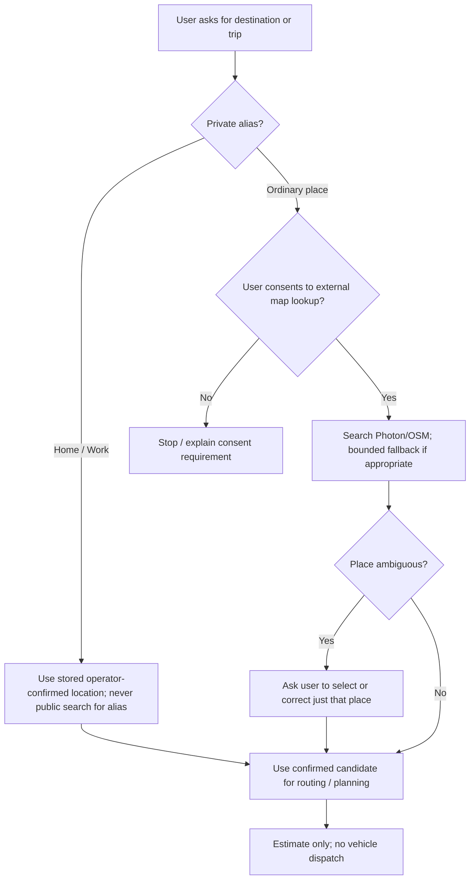

# Maps and charging-data integrations — what is built in

**Tesla Voice MCP includes map and routing backends, not a standalone interactive map UI.** The AI client can request destination search, addresses, road distances and charging candidates through tools. Whether it can render a graphical map depends on the client; a text route or station list is a valid response.

**Google Maps is optional.** Basic OSM-based search and routing do not require a Google Places API key or Google billing account, though public OSM services have usage policies and no production SLA.

## Provider overview

| Provider / data | Used for | Enabled by | Not a guarantee of |
| --- | --- | --- | --- |
| **Photon / OpenStreetMap** | Search named destinations and place candidates | `search_trip_destination`, `plan_smart_trip`; external-map consent | Exact entrance or perfect address |
| **Nominatim / OSM** | Bounded fallback for some map/geocoding paths | Appropriate source fallback under code policy | Full global coverage, unlimited queries |
| **OSRM routing** | Road geometry, driving distance and route alternatives | `plan_road_trip`, `plan_charging_road_trip`, `plan_smart_trip` | Current traffic, weather, Tesla native route or actual travel time |
| **OSM / Overpass** | Mapped charging station candidates and connector tags | `find_charging_sites`, charging corridor | Open, functional, free/available charging stall |
| **Italian station adapter** | Public Italian charging-site dataset normalization | Station discovery with source constraints | Live occupancy or tariff |
| **French IRVE adapter** | Public French charging dataset normalization | Station discovery with source constraints | Live occupancy or tariff |
| **German BNetzA adapter** | Public German charging registry normalization | Station discovery with source constraints | Live occupancy or tariff |
| **Swiss SFOE / ich-tanke-strom** | Swiss station data where licensing allows | Station discovery; reuse conditions apply | Commercial reuse rights without checking license |
| **Tesla Fleet API** | Vehicle-provided GPS and nearby Tesla charging sites | Tesla link, location scope, explicit request | Universal charging coverage or real-time pricing |
| **Google Places API (New)** | Optional POI name → Google Place ID with disambiguation | Private key, production gate, explicit consent, billing | Tesla-native charger identity or in-car multipoint acceptance |
| **Free To X public tariff source** | Public direct-card/POS tariff lookup for one provider | `get_free_to_x_card_tariffs` | Personal negotiated price, current station invoice or prices at other operators |

The same physical charging station may appear differently across providers. The project does not claim to merge every provider into one perfect global map.

## How a map-based request behaves

**Provider requests may disclose user-supplied names or coordinates to external services.** The code restricts provider origins and implements bounded requests, caching, backpressure and deliberate handling of provider errors. Fallback is **not** a way to circumvent a provider's rate limit.

## What is the difference between maps and Tesla navigation?

1. **Geocoding:** Converting a name or address into a location candidate. Accuracy varies.
2. **Road routing:** Estimating a driving route or distance using a map graph such as OSRM.
3. **Energy planning:** Applying assumed battery capacity, consumption, reserve and charging efficiency.
4. **Waypoint preparation:** Creating an ordered list of resolved destinations for possible later command handling.
5. **Actual Tesla navigation:** A **separately authorized** command, requiring transport support and independently observed vehicle results.

A road route generated with OSRM is **not automatically uploaded to Tesla**. Requested road exclusions depend on supported routing profiles/OSM tags; preferred road names are informational and are not applied to Tesla navigation. Tesla-native charger navigation and a mapped charger address are **not interchangeable**, especially for battery preconditioning.

## Charging and corridor-specific behavior

- `find_charging_sites` can search an area, including **AC** candidates when explicitly requested.
- `plan_charging_road_trip` optimizes a **DC/HPC CCS2** corridor only; it does **not** automatically insert slower AC charging stops into the corridor.
- Search results should state connectors, source and confidence/unknowns when provided. Do not claim real-time availability or live prices from a static public dataset.
- `compare_charging_costs` accepts **caller-supplied** tariffs; it does not auto-infer a customer's discounted tariff for unrelated networks.
- `get_free_to_x_card_tariffs` reports a public tariff when available, subject to source/terms; it is **not** a universal price engine.

## Privacy and permissions

| Action | Who receives data? | Required boundary |
| --- | --- | --- |
| Cached battery | Your private server and authorized AI client | `battery:read`; no implicit wake |
| Tesla location | Tesla and authorized client/server | `location:read`; explicit user request |
| External place search | Selected map provider | `location:read` and external-map consent |
| Google POI search | Google Places API (New) | Private API key, production gate, explicit consent, quota |
| Private alias lookup | Private store and client | No public text search for Home/Work |
| Tesla navigation dispatch | Tesla Fleet command infrastructure | Separate `vehicle:control`, feature gates, user intent and pairing |

**Self-hosted does not mean offline or provider-free.** Tesla, the chosen AI platform, OAuth issuer and public maps may process relevant data under their own terms.

## Provider limits and licensing

- OpenStreetMap content is subject to ODbL attribution/reuse requirements; public geocoding and routing endpoints have individual usage policies.
- National station sources have differing licenses and update schedules.
- Swiss station data in the current source carries a **non-commercial reuse restriction**: review terms before including it in a commercial offering.
- Google's Places (New) data and EEA-specific rules can restrict display and reuse; follow Google's current terms and avoid mixing returned content into an incompatible map visualization.
- Public servers are best-effort; commercial deployments may need a properly licensed provider or independently hosted infrastructure.

## Troubleshooting map behavior

| Issue | First check |
| --- | --- |
| Place not found | Spelling, city/country and provider coverage |
| Wrong or ambiguous place | Present candidates; ask user to select; no silent destination substitution |
| Private Home/Work missing | Save privately with explicit user confirmation; never infer from public search |
| Routing rejects exclusions | Provider may not support the requested class; do not silently compute unrestricted alternative |
| Provider rate-limited | Stop/back off under provider policy; do not rotate mirrors to evade the limit |
| Google missing/disabled | Check optional provider gate and private key; OSM does not require Google billing |
| Charging station without live availability | Return “availability unknown,” not “available now” |
| Station appears but no preconditioning | Address-based navigation is not guaranteed native charging-POI navigation |
| 16 destinations prepared but not shown | Preparation is not vehicle dispatch; see experimental navigation limits |

## Implementation references

`simulator/lib/road-trip.mjs` · `simulator/lib/map-providers.mjs` · `simulator/lib/google-waypoints.mjs` · `simulator/lib/charging-route.mjs` · `simulator/lib/european-stations.mjs` · `simulator/lib/osm-charging.mjs`

For a beginner-friendly setup see [Beginner's Guide](BEGINNERS_GUIDE.md). For the optional paid provider see [Google Places setup](GOOGLE_PLACES_SETUP.md). For source details and licenses see [Architecture](ARCHITECTURE.md).
