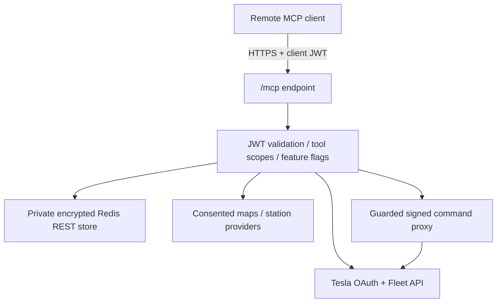

# Operator runbook — deploy, maintain and recover a private MCP

**Audience:** experienced developers, security reviewers and self-hosting operators. Start with [Beginner's Guide](BEGINNERS_GUIDE.md) if Git, OAuth, JWTs, HTTPS or Redis are new to you.

**Operating model:** one operator subject per isolated instance. This project is **not** a managed SaaS and does not provide hosting, OAuth credentials or Tesla Fleet access. Keep real commands disabled until separate acceptance checks have passed.

## System dependencies and ownership

| Component | Owner | Responsibility |
| --- | --- | --- |
| HTTPS host (Vercel-compatible Node + Go runtime) | Operator | Origin, deploy controls, logging, outbound access, costs |
| MCP OAuth issuer | Operator | RS256/JWKS, subject, audience, scope grants, revocation |
| Tesla Fleet application | Operator | Official enrollment, vehicle authorization, callbacks, pricing |
| Virtual key / command signing | Operator + Tesla | Pairing, protected signing keys, command validation |
| Redis REST store | Operator | Isolated storage, token protection, retention and recovery |
| Public maps and charging datasets | Providers | Coverage, terms, quota and source availability |
| AI client | User/workspace | Remote MCP eligibility, OAuth connection, tool approvals, speech if any |

All live operations depend on applicable Tesla, client and regional support.

## Deployment architecture



The canonical `APP_ORIGIN` determines the audience `<APP_ORIGIN>/mcp`. OAuth discovery is advertised at `/.well-known/oauth-protected-resource`; Tesla callback is `/oauth/tesla/callback`. The public Tesla app key endpoint is `/.well-known/appspecific/com.tesla.3p.public-key.pem`. Never serve the *private* signing key.

## Preflight and rollout sequence

### Phase A — local verification (no Tesla)

```sh
node --version
go version
node simulator/prepare-artifact.mjs
node --test simulator/*.test.mjs
(cd simulator && go test ./... && go build ./... && go vet ./...)
```

Check isolated Redis integration tests in `.github/workflows/tesla-multipoint-ci.yml`. Review the exact branch commit and [CI evidence](EVIDENCE.md). Tests must use synthetic identifiers and disposable infrastructure. The local preparation artifact is not a deploy.

### Phase B — authentication and storage

1. Configure private HTTPS hosting with `simulator/` as the Vercel project root; verify the deployment origin.
2. Configure `MCP_AUTH_ISSUER`, `MCP_AUTH_JWKS`, `MCP_ALLOWED_SUBJECT` and required scope issuance.
3. Configure `TOKEN_STORE_REST_URL`, `TOKEN_STORE_REST_TOKEN` and a unique 32-byte `TOKEN_ENCRYPTION_KEY_BASE64` in protected secret settings.
4. Create your own Tesla Fleet app with its exact callback, region, authorized vehicle and required minimum scopes.
5. Configure provider-side cost ceilings/alerts; confirm the scope of `TESLA_DAILY_READ_LIMIT`.
6. Keep `TESLA_COMMANDS_ENABLED` and `TESLA_COMMAND_EXECUTION_ENABLED` disabled.
7. Deploy only when necessary configuration is present and authorization boundaries are known.

**Avoid copy/paste “enable everything” templates.** Additional gates exist for special navigation modes; read [Configuration](CONFIGURATION.md) and source guards before enabling them.

### Phase C — validate remote access

- Request protected-resource metadata; verify the issuer/resource advertised.
- Confirm a request without valid MCP auth is rejected.
- Test wrong `iss`, `aud`, `sub`, expired signature and insufficient scope using synthetic test tokens.
- Connect an approved MCP-capable AI client; inspect discovered tools and their schemas.
- Request `get_connection_status` without calling Tesla.
- Explicitly link your own Tesla account via `connect_tesla`; do not paste Tesla tokens into the client.

### Phase D — read-only and maps

- Confirm `get_battery` returns cached state with timestamp (or an explicit no-data condition).
- Perform exactly one live read *only when requested*; record source timestamp and quota.
- For maps, verify consent flow, geocoding disambiguation and privacy of saved aliases.
- For charging, distinguish AC local search from DC/HPC CCS2 route-stop optimization and report unknown site/tariff fields.

### Phase E — controlled vehicle operations

Enable only the necessary Tesla control scopes, registration, virtual-key pairing and server gates after prior stages pass. Test one explicitly requested, low-risk action **while safe and parked**. Inspect command receipt and independently verify the physical result.

For multipoint navigation, validate preparation and ordering offline first. Any signed GPS/native route attempt is an **experimental write**, separately authorized and inspected on the vehicle display. Never auto-repeat after an unknown result.

## Go/no-go table

| Area | Go evidence | No-go signal |
| --- | --- | --- |
| Deployment | HTTPS and exact `APP_ORIGIN`, healthy logs | Invalid origin, unexpected public access |
| Auth | Invalid JWT/scope rejected, one operator subject | Any auth bypass, shared unknown subject |
| Storage | Encrypted isolated Redis, protected recovery | Secrets in source/logs or public datastore |
| Costs | Provider budgets, quotas and alerts configured | Unbounded paid live reads |
| Read tools | Timestamps, explicit cached/live status | Stale data misrepresented as fresh |
| Commands | Minimal scopes, valid pairing, independent observation | Only API acceptance or uncertain duplicate |
| Multipoint | All ordered stops physically observed | Prepared route or acceptance only |
| Release | License and data terms reviewed, scanner on final commit | Unverified private refs or sensitive artifacts |

## Monitoring without disclosing sensitive data

Useful operational signals: deployment revision, tool name, safe error code, provider category, time, elapsed duration, request budget, cache age, command lifecycle stage. Remove/tokenize vehicle identifiers, exact coordinates, tokens, callback codes, sensitive destination names and signed payloads before logging.

An HTTP 2xx or `tesla_accepted` result must not be relabeled as independent physical confirmation. Cache age and provider data age should remain visible to users.

## Costs and provider policy

- **Tesla Fleet API:** metered usage; configure billing limits in the provider account and set a local read budget. Review [official billing documentation](https://developer.tesla.com/docs/fleet-api/billing-and-limits).
- **Hosting, Redis and OAuth:** each may have free tiers, quotas or charges that change; verify pricing directly.
- **Google Places (New):** optional; paid/billing-enabled project may be required. Use OSM/Photon for the supported non-Google lookup path when appropriate.
- **Public maps / station data:** subject to rate limits, attribution and reuse licenses; do not treat public endpoints as guaranteed production SLAs.
- **Charging tariffs:** prices may depend on operator, location, contract, payment method and date. Never infer universal tariffs.

**Cost control hierarchy:** provider billing cap → least-privilege feature gates → app request budget → explicit user authorization → sanitized usage monitoring.

## Recovery and incident response

### OAuth or client access failure

Verify `APP_ORIGIN`, audience, issuer/JWKS, subject and scopes. Do not disable validation to diagnose client compatibility. Some AI clients cache the discovered tool list; consult the platform's documented refresh/reconnect process after changes.

### Lost token encryption key

Encrypted records may become unreadable without the original key. Restore from a protected backup; if unavailable, plan a safe reauthorization path. Never store the key in a Git issue or publish recovery material.

### Exposed credential (only if evidence exists)

1. Disable affected deployment/tool access as appropriate.
2. Revoke/rotate the specific compromised credential at the relevant provider.
3. Invalidate sessions/tokens where supported.
4. Investigate repository history, logs, CI artifacts, deployment settings and leaked copies.
5. Restore with a new secret and re-test the affected boundary.
6. Document the incident privately; do not paste the exposed secret into a new report.

### Unknown vehicle command outcome

Inspect `get_vehicle_command_status`, provider/transport receipt and the car itself. **Do not blindly repeat** unlock, navigation, trunk, schedule or drive-enabling operations.

### Map, routing or charger provider outage

Report unknown or unavailable data. Do not invent coordinates, stations, prices or charging times. Change providers only when consent, terms and source quality permit.

### Revert a documentation change

Use Git revert or a new corrective commit on the review branch; do not force-push history shared with reviewers. Any code or deployment rollback is separate and needs explicit operator approval.

## Production vs open-source release

Publishing source does **not** authorize a deploy, pair a vehicle, grant provider credentials, make a server public or verify an AI client's tool permissions. The release checklist remains a separate gate. See [Publication checklist](PUBLICATION_CHECKLIST.md).

## References

[Architecture](ARCHITECTURE.md) · [Configuration](CONFIGURATION.md) · [Security model](SECURITY_MODEL.md) · [Client setup](CLIENT_SETUP.md) · [Troubleshooting](TROUBLESHOOTING.md) · [Evidence](EVIDENCE.md).
