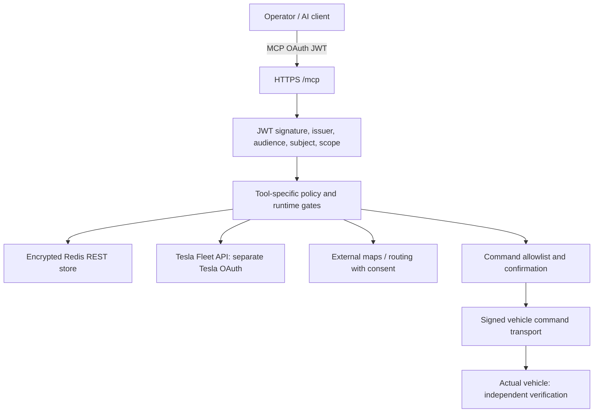
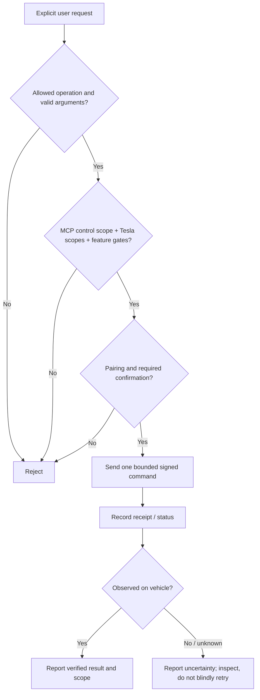

# Security, privacy and command safety model

This is a **security architecture description**, not a penetration-test certificate or guarantee that any deployment is secure. The code is intended for one authorized operator per isolated instance.

## Trust boundaries

### Boundary 1: MCP client authentication

The MCP access token is **not** a Tesla OAuth token. The server checks RS256 signature, trusted JWKS, exact issuer, resource audience, expiration, allowed subject and tool-specific scopes. `MCP_ALLOWED_SUBJECT` enforces a single configured operator. Do not bypass it to support arbitrary public clients.

### Boundary 2: Tesla account and authorization

The operator separately connects their own Tesla account through `connect_tesla`. Tesla app credentials, owner consent, Fleet scopes, regional access, partner registration and virtual-key pairing are independent prerequisites. A successful MCP login cannot grant Tesla permissions.

### Boundary 3: Persistent secrets and private data

The server uses private Redis REST storage and a unique server-side encryption key. Store:
- Tesla access/refresh tokens and client secrets **only in private secret management**;
- encryption keys and Redis tokens outside source control;
- private aliases, destinations and preference data in isolated encrypted storage.

Never expose real VINs, exact location, addresses, signed request headers, token values or private tariffs in README files, issues, CI artifacts, screenshots or support requests. If a specific key is exposed, revoke/rotate it with the provider and investigate logs/history; removing the line from a current file is insufficient.

### Boundary 4: External map consent

Geocoding and routing can transmit a query or location to OSM/Photon/Nominatim, OSRM, Google Places or station-data providers. Require the appropriate consent, identify the provider and do not claim that self-hosting eliminates third-party processing.

### Boundary 5: Side-effecting vehicle commands

- A command listed in the catalog is **not** automatically enabled.
- `prepare_vehicle_command` stages a command; `execute_vehicle_command` uses its confirmation protocol.
- `execute_requested_vehicle_command` is still subject to explicit intent and server-side policy.
- `wake_up` must not run implicitly.
- Do not retry commands when the prior outcome is uncertain.
- API acceptance is **not** physical execution, especially for native/multipoint navigation.

## Threats and mitigations

| Threat | Relevant mitigation | Residual risk |
| --- | --- | --- |
| Stolen MCP token | JWT signature/issuer/audience/subject/scope/expiry | Token can be abused until revoked/expired |
| Exposed Tesla refresh token | Server-side encrypted store, restricted access, rotation procedure | Host compromise or bad logs can still leak secrets |
| Prompt injection via a map/provider result | Treat tool outputs as data; preserve independent user intent and allowlist | AI client behavior must also be reviewed |
| Excessive API spend | Local read budget, provider quotas, cost alerts | Provider-side billing may exceed local estimates |
| Accidental vehicle write | Command gates, scopes, confirmation and allowlist | Tesla/firmware response may differ |
| Location disclosure | Consent, private aliases, restricted logs | External providers still process queries |
| Wrong destination | Disambiguation and user verification | Map coverage and entrance precision vary |
| Duplicate/partial multipoint | Separate transport, receipts and physical display check | Experimental transport may be incomplete |

## Safe publication checklist

- [ ] No live credentials, VINs, private addresses, real GPS traces or personal tariff contracts in the **entire reachable Git history**.
- [ ] No sensitive metadata in commit authors, release assets, CI logs or screenshots.
- [ ] Independent secret scanner run on final commit, with redacted logs.
- [ ] No real vehicle calls in CI; no production Redis use.
- [ ] All docs use synthetic examples and no operator-specific infrastructure.
- [ ] Third-party map/station-data terms and attribution reviewed.
- [ ] Release/visibility change explicitly approved.
- [ ] Provider-side revocation status separately verified if an actual historical exposure is identified.

See [SECURITY.md](../SECURITY.md) for disclosure handling and [PUBLICATION_CHECKLIST.md](PUBLICATION_CHECKLIST.md) for the release gate.
