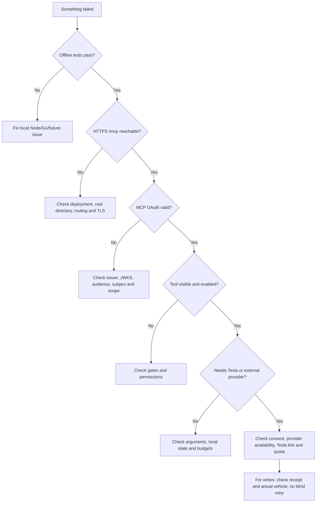

# Troubleshooting and diagnostic playbook

## Diagnose without guessing

Before editing configuration, record **which boundary failed**. A missing tool can mean a gate, a denied tool call can mean an OAuth scope, and a Tesla-accepted command can still fail to appear on the car. These problems should not be "fixed" by enabling every flag.

| Observed failure | First layer to inspect | Never do this |
| --- | --- | --- |
| Cannot reach `/mcp` | Hosting, root directory, HTTPS, routes | Publish a secret-bearing debug endpoint |
| Client cannot authenticate | MCP OAuth issuer, audience, signature, subject | Disable OAuth or paste a Tesla token into chat |
| Tool is missing | Runtime gate, client scope, cached tool list | Assume source implementation means tool exposed |
| Data unavailable or stale | Cached/live semantics and Tesla state | Manufacture a new timestamp |
| Charger not found or wrong | Provider consent, availability, query ambiguity | Invent a station or price |
| Multi-stop "accepted" but no itinerary | Experimental transport and physical display | Fire repeated single-destination requests |
| Command outcome unknown | Server receipt, independent car state | Blindly retry a physical operation |

For long-term operations and rollback steps, see [Operator runbook](OPERATOR_RUNBOOK.md).

Start with the **least invasive** check. Avoid real vehicle calls until authentication, configuration and read-only behavior are understood. Never post credentials, VINs, private addresses, full JWTs or exact GPS traces in public support requests.

## Client, voice and map troubleshooting links

- **Claude/Gemini/Grok cannot connect**: inspect [AI Clients](AI_CLIENTS.md) and [Compatibility matrix](COMPATIBILITY_MATRIX.md). A vendor's support for MCP does not prove this server's OAuth issuer, JWT claims or protocol negotiation are compatible.
- **Text tools work but voice does not**: follow [Voice Usage](VOICE_USAGE.md); a voice session may not support connected apps even if chat does.
- **Cannot obtain or choose a Google Place ID**: use [Google Places / Place ID setup](GOOGLE_PLACES_SETUP.md). Do not invent an ID or assume it is Tesla-native.
- **Wrong map result or station**: see [Map providers](MAP_PROVIDERS.md); ask users to select ambiguous places and keep availability unknown when data is stale.

## 1. Quick diagnosis

## 2. Local build or CI failure

| Symptom | Check | Safe next action |
| --- | --- | --- |
| Node syntax/runtime error | Node.js 22+ | Confirm version; rerun only relevant offline test |
| Go compile/vet failure | Go 1.23+, pinned module versions | Run `(cd simulator && go test ./... && go build ./... && go vet ./...)` |
| Test unexpectedly reaches external network | Fixture isolation | Stop; inspect mock boundaries; never supply production secrets |
| Redis integration fails | Test Redis URL and isolation | Use dedicated disposable Redis; do not point tests to production |
| Build passes but deployment fails | `simulator/` root, `vercel.json` routing, environment variables | Inspect sanitized deployment logs |
| Gitleaks finding | File and commit history | Do not publish; revoke a real exposed secret before remediation |

## 3. OAuth and MCP errors

| Symptom | Likely cause | Check |
| --- | --- | --- |
| 401/unauthorized | Wrong issuer, JWT signature, expiry, audience or subject | `APP_ORIGIN`, `MCP_AUTH_ISSUER`, JWKS and `MCP_ALLOWED_SUBJECT` |
| Insufficient scope | Client has not authorized a tool's scope | `battery:read`, `location:read`, `tesla:connect`, `vehicle:control` |
| OAuth loops | Resource metadata, callback or audience mismatch | Exact `https://<host>/mcp` resource and issuer settings |
| No tools listed | Runtime gates or missing permissions | `tools/list` and deployed revision |
| Client supports only local MCP | Unsupported remote transport/OAuth | Use a compatible remote client; do not disable auth |
| Tesla account not linked | Tesla OAuth flow incomplete | Explicit `connect_tesla`; check `get_connection_status` |
| Partner registration incomplete | Tesla/virtual-key prerequisites | Consult official Tesla requirements; do not blindly retry registration |

**Never fix an auth failure by exposing a Tesla token to the client or turning off verification.**

## 4. Vehicle readings and freshness

| Symptom | Meaning | Response |
| --- | --- | --- |
| Cached battery differs from app | Snapshot is old | State timestamp; request one live read only if explicitly authorized |
| Live read unavailable | Vehicle asleep/offline, Tesla API failure or quota | Report uncertainty; no automatic retry/wake |
| Missing tire pressure or climate field | Vehicle/API did not provide it | Do not synthesize a value |
| History empty | No app-collected samples yet | History is not background telemetry |
| Nearby charger list incomplete | Tesla/provider coverage | Do not infer that no chargers exist |

## 5. Maps and navigation

| Symptom | Likely cause | Response |
| --- | --- | --- |
| No destination found | Incomplete provider data or query | Ask for city/address clarification |
| Multiple similarly named places | Ambiguous geocoding | Present candidates; do not guess |
| Home/Work alias not resolved | No private saved alias | Ask user to configure it privately |
| Google resolver disabled | Optional key/gate/consent missing | Use OSM when appropriate; no mandatory Google billing |
| 17 navigation-only destinations rejected | Hard planner limit | Split request with user approval; do not silently drop a stop |
| Energy planner rejects >8 intermediate stops | Different limit from navigation-only | Reduce intermediate energy stops explicitly |
| Native waypoint payload prepared but nothing on screen | Preparation is not dispatch | Explain state; do not claim success |
| Tesla API accepted multipoint but display differs | Experimental transport/firmware behavior | Check every stop physically, in order; no blind retry |
| Charging station address works but no preconditioning | Address is not Tesla-native charging POI | Do not promise battery preconditioning |

## 6. Command execution and uncertain outcomes

1. Inspect `get_vehicle_command_catalog` for actual operation support and required permissions.
2. Confirm the operator explicitly requested this action.
3. Check `vehicle:control`, Tesla scopes, execution gates, partner registration and virtual key.
4. Inspect the result/receipt using `get_vehicle_command_status` where applicable.
5. Verify the physical result independently, while parked and safe.
6. If the prior request might have executed, **do not repeat it automatically**.

`accepted`, `queued`, `prepared` and `observed` are not interchangeable. GPS diagnostic Replace and Append are separate operations with separate user authorization and physical inspection requirements.

## 7. Provider and cost issues

- Tesla Fleet API is usage-metered; consult current provider pricing and quotas.
- Google Places (New) can require billing and API-specific quotas; it is optional.
- Public OSM/Photon/Nominatim and OSRM services have usage policies and no guaranteed SLA.
- Charging datasets have varying licensing, attribution, coverage and freshness.
- A price comparison is valid only for the operator, payment method, source and date specified.
- Never expose real provider keys to debug a cost or quota issue.

## 8. Safe support bundle

For a GitHub issue, include **only**:
- application version or commit SHA;
- offline Node/Go versions and sanitized test outcome;
- tool name and **error code** (not tokens or raw payloads);
- whether the data was cached/live/estimated;
- whether the operation was merely prepared, accepted or independently observed;
- sanitized, fictional reproduction steps.

Do **not** include raw environment files, `Authorization` headers, signed payloads, exact vehicle position, VIN, real places, OAuth callback codes, Redis contents or private command receipts.

Related: [Installation](INSTALLATION.md) · [Client setup](CLIENT_SETUP.md) · [Security](SECURITY_MODEL.md) · [Tools](TOOLS_REFERENCE.md).
