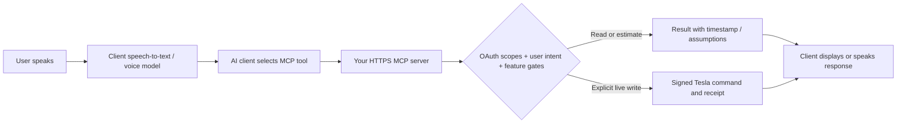

# Voice and Tesla Voice MCP — what works, what depends on the AI client

**Tesla Voice MCP provides tools, not a microphone or speech engine.** You can interact in natural language through compatible AI applications. **Voice is possible only when that specific client/mode can both process speech and invoke connected MCP tools.** Voice support must be validated separately from text-tool compatibility.

## How voice can reach the vehicle

The AI client determines **whether** it uses a tool and whether speech output is supported. The server determines **whether a requested operation is authorized**. A command requires explicit intent and server-side policy even when the request was spoken.

## Three modes that are often confused

| Mode | What the user does | Does this guarantee an MCP call? |
| --- | --- | --- |
| **Text chat** | Types a request in an AI conversation with the connector enabled | Only if client supports and chooses the tool |
| **Dictation to text chat** | Speaks into a keyboard/dictation feature, then sends the resulting text | Often behaves like text input, but client-specific |
| **Native real-time Voice/Live** | Talks to the assistant in a dedicated voice session | **No.** Some platforms do not support custom MCP app tools in this mode |

**As of 2026-11-17:**
- **ChatGPT:** [OpenAI's Apps FAQ](https://help.openai.com/en/articles/11487775-connectors-in-chatgpt) states that **Voice mode currently does not support apps**. Thus, do **not** claim universal hands-free ChatGPT Voice → Tesla MCP support based on custom MCP availability in text chat.
- **Claude:** Native voice and remote custom connectors are both documented, but their **combined use with this exact server has not been tested**.
- **Gemini:** Gemini Apps, Gemini CLI and Gemini Live are different product surfaces; custom MCP connection in one does not prove custom tools can run in Gemini Live.
- **Grok:** xAI's developer [Speech-to-Speech API](https://docs.x.ai/developers/model-capabilities/audio/speech-to-speech) documents remote MCP tools. A **custom developer-built voice client** is conceivable; consumer-app voice use with this server remains unverified.
- **Other apps:** assess each product's voice session, connector permissions and OAuth support separately.

## Examples of voice-ready phrasing — only when the client supports MCP tools

These are **example utterances**, not recorded or guaranteed working voice requests.

| Say | Expected tool workflow | Side effects |
| --- | --- | --- |
| “What's the last known battery level? Don't wake the car.” | `get_battery` | Cached read, no implicit wake |
| “Estimate a 150-kilometer trip with a 15-percent reserve.” | `estimate_trip_energy`, with supplied assumptions | Calculation only |
| “Find a charging location near the destination.” | `find_charging_sites` with map consent | External map lookup; no Tesla command |
| “Prepare a three-stop trip; don't send anything.” | `plan_smart_trip` | Plan only; no dispatch |
| “Show available lock and climate actions; don't execute them.” | `get_vehicle_command_catalog` | Catalog only |
| “Send this destination to the car.” | Guarded command pathway **only if explicitly supported and authorized** | May change navigation; verify on vehicle |

**Never imply consent to unlock, honk, start driving or send navigation just because a spoken conversation sounds informal.** A request to **prepare** is not authorization to **execute**. For outcomes that may be uncertain, no blind retry.

## Safest onboarding path for voice users

1. Configure your private server and an eligible AI client's **text-based MCP integration** first.
2. Test `get_connection_status` and `estimate_trip_energy` with synthetic values.
3. Verify cached `get_battery` only when the operator's Tesla OAuth is intentionally linked.
4. Confirm whether the chosen client/mode officially supports invoking **that custom MCP connector from voice**.
5. Try a **read-only voice request**, using fictional/synthetic values where possible.
6. Compare the tool activity and response with the same text request; do not assume a spoken answer implies the MCP ran.
7. Test **physical** commands only in a separate guarded acceptance procedure; never use an untested voice integration to operate a vehicle unsupervised.

## Voice status label

The correct public statement is:

> **Works with supported AI clients via text-based remote MCP integrations; voice control is client-dependent and requires separate verification.** A developer can build a dedicated speech front end where platform APIs allow tool invocation. This repository does not include such a front end.

If a specific voice surface is tested later, record the exact app/version, account plan, OAuth method, permission scope, tool name and observed result in [Compatibility test matrix](COMPATIBILITY_MATRIX.md).

See [AI clients](AI_CLIENTS.md), [Beginner's Guide](BEGINNERS_GUIDE.md), [Practical workflows](WORKFLOWS.md), and [Security model](SECURITY_MODEL.md).
