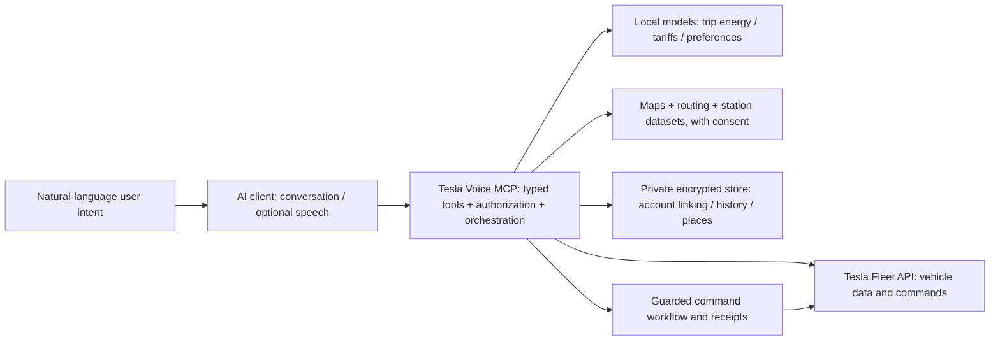

# Beyond the Tesla API: Why Tesla Voice MCP Exists

**Vehicle APIs provide capabilities. Tesla Voice MCP turns selected capabilities into discoverable, permission-aware tools and multi-step workflows for AI clients.**

This is the core distinction. Tesla Voice MCP is **not a replacement for Tesla Fleet API**, nor a new Tesla vehicle capability. It is an open-source, self-hosted integration and orchestration layer built around Tesla Fleet API, separate planning logic, maps, charging datasets and the Model Context Protocol (MCP).

## See the difference in 60 seconds

**Who provides what?**

| Layer | Responsibility | Not its responsibility |
| --- | --- | --- |
| Tesla Fleet API | Tesla account/vehicle data, authorized operations and Tesla-side enforcement | Providing this project's comparative tariff engine or unified map/energy workflow |
| AI client | Understand natural language, decide when to request a tool, present results, optional voice interaction | Owning the server's security policy or proving that an API response physically changed the vehicle |
| Tesla Voice MCP | Define typed tools, expose authorized capabilities, orchestrate calculation/map/vehicle workflows, store private state, enforce configured guards | Being an autonomous model, a Tesla app, a guaranteed 16-stop navigation system or a universal hosted service |
| External map/station sources | Provide geographic data, road distances and charging candidates | Guaranteeing stall availability, tariffs, exact entrances or Tesla-native preconditioning |

MCP is a **tool interoperability protocol**, not an AI model. The conversational “intelligence” comes from a compatible AI client working with structured tools; deterministic calculations, policy enforcement and data joins happen in the server.

## Fleet API, a custom app and this MCP: an honest comparison

A developer can build sophisticated workflows **directly on top of Fleet API** in a traditional app. MCP does not make such software impossible without MCP. Its value is a **reusable, discoverable assistant-facing interface** plus the particular workflows and protections implemented in this repository.

| Need | Calling Tesla Fleet API directly | Building a bespoke REST application | This project's MCP implementation |
| --- | --- | --- | --- |
| Read Tesla battery/status | Supported by authorized Tesla endpoints | Implement your own request and UI | Typed tools for cached and on-demand reads with timestamps |
| Use natural-language questions | Not supplied by Fleet API itself | Integrate an LLM / NLP layer yourself | Designed for compatible AI clients that can call MCP tools |
| Expose a tool catalog to assistants | Custom integration required | Define proprietary adapters/functions | MCP `tools/list`, `inputSchema`, scopes and descriptions |
| Combine vehicle data and map results | Implement multi-provider orchestration | Build and maintain joins | Separate Tesla, OSM/Photon/OSRM and optional Google paths |
| Estimate route energy and charging economics | Implement your own planner | Build formulas and provider adapters | Built-in bounded calculators, reserve checks and charging comparisons |
| Prepare complex multi-stop requests | Implement route/waypoint handling | Build custom resolver and safety logic | Navigation-only planning for 2–16 ordered destinations; vehicle delivery remains experimental |
| Distinguish cached, live and estimated data | Implement freshness semantics | Design data provenance | Explicit tool semantics, timestamps and estimation boundaries |
| Protect remote commands | Tesla-side auth still required | Add app auth, consent and lifecycle | MCP OAuth, tool scopes, allowlist, feature gates, staged/direct guarded paths and receipts |
| Connect several compatible AI front ends | Custom integration per client | Maintain client-specific APIs | Reusable remote MCP surface, **subject to each client's OAuth and capability support** |
| Self-host and audit logic | Your own implementation | Your own implementation | Open-source code, tests and operator-managed credentials |

This is **functional depth**, not proof of market uniqueness, superior latency, operating savings or compatibility with every car and assistant.

## Five areas of added value

### 1. Assistant-native tool interoperability

The project exposes **38 documented MCP tool entry points** for linking, reads, trip planning, destination resolution, maps, charging, preferences and command handling. The live list varies with configuration and authorization.

A compatible assistant can discover tool names, argument schemas and permission requirements. A conventional REST integration often needs a separate adapter layer to achieve similar assistant-facing functionality.

**Boundary:** The server does not contain its own speech engine or language model, and no particular chat subscription is guaranteed to support custom remote MCP.

### 2. Context-rich vehicle information

Examples include cached battery/status with timestamps, optional live vehicle reads, connectivity status, charging-session history and **application-collected** vehicle-reading history.

**Boundary:** A cached reading is not live telemetry. This is not a continuous polling service or Tesla's entire historical dataset. On-demand reads may contact or wake the vehicle and consume metered quota.

### 3. Trips, charging and mapping as a connected workflow

The repository combines energy estimates, reserve thresholds, road-routing data, charger candidates, charging efficiency and caller-supplied tariff comparisons. It supports OSM/Photon/OSRM and selected European charging-station sources, plus optional Google Places (New).

**Boundary:** It does not reproduce Tesla's native BMS range model, current stall occupancy or guaranteed prices. AC discovery is separate from DC/HPC CCS2 automatic stop planning. Provider terms, consent, freshness and cost remain material.

### 4. Advanced itinerary preparation

`plan_smart_trip` supports a **navigation-only mode with 2–16 ordered destinations**, ambiguity resolution, private aliases and retrievable plans. A distinct energy-planning mode limits trips to **eight intermediate stops**. Native waypoint and GPS execution paths are **experimental** and independently gated.

**Boundary:** Preparing a route or receiving an API acknowledgment is **not** proof that every destination appeared on the Tesla display. Never silently substitute repeated single-destination commands.

### 5. Deliberate security and command handling

The implementation separates **MCP-client OAuth** from **Tesla OAuth**, validates per-tool scopes and one configured operator subject, protects private tokens/storage and uses allowlisted commands. Control paths have preparation/confirmation or guarded direct execution, receipts, explicit user-intent requirements and no blind retry policy.

**Boundary:** A policy in source is not a security certification. The actual result depends on deployment configuration, correct Tesla permissions, client behavior and independent verification on the car.

## What the project does *not* provide

- A new or privileged Tesla API, bypass of Fleet authorization or access to another operator's vehicle.
- A hosted service, turnkey mobile app, built-in audio model or guaranteed compatibility with all AI clients.
- Free Tesla API usage, free Google Places, unlimited public geocoding or verified live charger availability.
- A manufacturer-certified trip planner, charging curve, battery capacity measurement or safety-critical driving system.
- Automatic Tesla preconditioning by navigating to an arbitrary charger address.
- Guaranteed native navigation with 16 destinations displayed in order.
- General support for **75 working commands on every Tesla**. The code catalogs 75 operation names; eight default SDK transports are unavailable in the pinned proxy, with some separately gated experiments.

## Proof over marketing

Use these terms consistently in the documentation and project discussions:

| Status | Evidence required |
| --- | --- |
| **Implemented in source** | Tool/module/guard exists in the inspected commit |
| **Verified offline** | Named passing automated tests under controlled fixtures |
| **Provider accepted** | Actual authorized service response, with an identifiable request |
| **Verified on vehicle** | Independent observation of the effect, with model/firmware/operation scope |
| **Estimated** | Formula, units, user inputs and stated limitations |
| **Not verified** | No adequate evidence; must not be advertised as tested |

See [Evidence and readiness](EVIDENCE.md), [Guided workflows](WORKFLOWS.md), [Tool reference](TOOLS_REFERENCE.md) and [Security model](SECURITY_MODEL.md).

## The strongest truthful positioning

> **Tesla Voice MCP is an assistant-native orchestration layer for Tesla data, permitted vehicle actions, travel planning and charging intelligence. It combines typed tools, multi-provider calculations, private operator context and explicit safety gates in an auditable, self-hosted MCP server.**

That proposition is stronger—and more defensible—than claiming to be an “AI Tesla API replacement” or a fully validated autopilot for remote commands.
