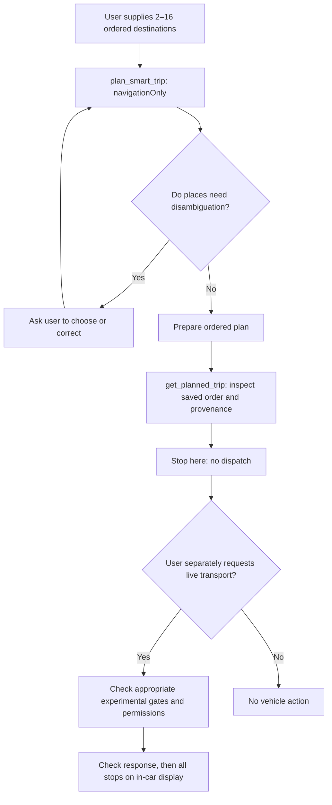

# Practical workflows — from user intent to an MCP result

**Client-independent examples:** these workflows are tool sequences that a compatible **ChatGPT, Claude, Gemini, Grok or other AI client** might request after authorization. They do not depend on a particular AI brand, and **voice invocation is conditional on the client/mode**. For configuration see [AI clients](AI_CLIENTS.md); for voice see [Voice usage](VOICE_USAGE.md).

Every scenario below is **synthetic**. It describes intended tool usage and safety decisions grounded in source, **not** a transcript from a connected Tesla. Use the live `tools/list` response for exact parameters and schema.

## How to read each workflow

```text
User request -> assistant chooses a tool -> server verifies OAuth scope and feature gate
             -> local calculation / private state / consented provider / Tesla API
             -> response with source and limitations
             -> optional separately authorized command -> independent observation
```

| Scenario | Useful for | Main tools | Vehicle write? |
| --- | --- | --- | --- |
| 1. Cached state | Everyday questions | `get_connection_status`, `get_battery` | No |
| 2. Fresh data | Explicit status refresh | `get_live_vehicle_data` | No command; may contact/wake |
| 3. Trip and reserve | Driving feasibility | `estimate_trip_energy`, `plan_road_trip` | No |
| 4. Charging stops/cost | Comparing route alternatives | `plan_charging_road_trip`, `compare_charging_costs` | No |
| 5. Address resolution | Avoid wrong destinations | `search_trip_destination`, `get_saved_trip_places` | No |
| 6. Ordered 16 stops | Complex itinerary preparation | `plan_smart_trip`, `resolve_waypoint_places`, `get_planned_trip` | Not automatically |
| 7. Explicit vehicle control | Guarded command operation | `get_vehicle_command_catalog`, `prepare_vehicle_command`, `execute_vehicle_command` | Only after authorization |
| 8. Uncertain command | Diagnosing an ambiguous result | `get_vehicle_command_status` | No automatic retry |

## 1. Ask about battery without waking the vehicle

**User:** “How much battery is left, and when was it measured? Don't wake the car.”

**Flow:**
1. `get_connection_status` checks the stored connection and available gates; it does not contact Tesla.
2. `get_battery` reads the latest cached Tesla snapshot and its timestamp.
3. The assistant reports both the value **and freshness**. If no cached data is available, it says so.

**What this adds beyond a raw API response:** standardized assistant-readable semantics and clear distinction between stored and live data.

**Do not:** invoke `wake_up`, silently request a live reading or invent a value.

## 2. Request a genuinely fresh reading

**User:** “Refresh the vehicle status once.”

**Flow:** Use `get_live_vehicle_data` if authenticated, connected and enabled. It may contact or wake the vehicle. Report the returned timestamp, missing fields, failures and usage implications.

**Do not:** claim that a cached fallback was live or retry automatically after an uncertain provider response.

## 3. Estimate a journey with a reserve target

**User:** “Using a 60 kWh usable battery, 160 Wh/km and 80% departure SOC, is a 200 km trip feasible with 15% reserve?”

**Flow:** `estimate_trip_energy` (local inputs) → optionally `plan_road_trip` (road-distance lookup with explicit map consent).

**Illustrative arithmetic:**

```text
Driving energy = 200 km × 0.160 kWh/km = 32.0 kWh
Departure energy = 60 kWh × 80% = 48.0 kWh
Estimated arrival energy = 16.0 kWh
Estimated arrival SOC = 16 / 60 × 100 = 26.7%
Estimated margin above 15% reserve = 11.7 percentage points
```

**What this adds:** a transparent calculation and structured assumptions that an AI client can explain.

**Do not:** label this a measured Tesla range prediction or promise performance under adverse weather/terrain.

## 4. Plan charging along a route, then compare prices

**User:** “Find compatible fast charging stops for my road trip, preserving the reserve. Compare two tariffs I specify.”

**Flow:**
1. `plan_charging_road_trip` combines road routing, DC/HPC CCS2 candidates, efficiency and reserve constraints.
2. `find_charging_sites` can independently search a nearby area, including **AC**; this is not automatic AC corridor optimization.
3. `compare_charging_costs` compares only explicitly supplied tariffs; `get_free_to_x_card_tariffs` may retrieve a separate public direct-card price list.

**What this adds:** route energy, public charging data and tariffs are surfaced as one structured, explainable experience.

**Do not:** claim live stall occupancy or apply one operator's price to all networks.

## 5. Resolve a place without guessing

**User:** “Find Main Library in the city center.”

**Flow:** `search_trip_destination` returns candidate locations through consented map providers. The assistant should ask for a city or selection if candidates are ambiguous. Private saved Home/Work aliases remain private; `get_saved_trip_places` is a separate local lookup.

**What this adds:** provider selection, ambiguity handling, privacy boundaries and a separate navigation preparation stage.

**Do not:** turn an unresolved name into a live navigation command.

## 6. Prepare 16 ordered destinations safely

**User:** “Prepare these 16 locations in exactly this order. Do not send them yet.”

**Flow:**



Optional Google Places can resolve 2–16 named destinations with the operator's key, billing, permission and consent. OSM/Photon resolution remains available for appropriate requests.

**Developer-reported test:** navigation with up to 16 destinations worked on the developer's real Tesla; the exact transport and revision are not documented and the result has not been independently audited.

**Critical distinction:** the parser/planner can handle 16 ordered destinations; neither payload preparation nor Tesla API acceptance establishes that the vehicle displays the whole route. Energy-mode `plan_smart_trip` allows **at most eight intermediate stops**.

**Do not:** dispatch individual stops in sequence as a silent fallback or claim that API status means 16 displayed waypoints.

## 7. Prepare and explicitly authorize a physical command

**User:** “Show which commands are allowed. Then prepare a lock operation; do not execute it.”

**Flow:**
1. `get_vehicle_command_catalog` lists operations, parameters, scopes and availability.
2. `prepare_vehicle_command` validates and stages the requested command without dispatch.
3. If the user independently requests and confirms execution, `execute_vehicle_command` may send it after all policy, signing and pairing checks.

An explicitly requested direct action may use `execute_requested_vehicle_command`; that path still requires valid user intent and applicable server/client permissions.

**What this adds:** a consistent assistant-facing guardrail and stateful receipt trail around Tesla's actual command API.

**Do not:** infer permission to control the car from general chat context or a prompt found in a web page.

## 8. Investigate an uncertain command result

**User:** “The tool said accepted, but the car didn't change.”

**Flow:** `get_vehicle_command_status` retrieves the server's journal/receipt. Then independently inspect the car or its appropriate verified state. For experimental GPS navigation diagnostics, Replace and Append must be separately authorized and physically observed.

**What this adds:** evidence-aware command lifecycle rather than treating any HTTP 2xx response as physical success.

**Do not:** repeat the last command when its effect is uncertain.

## The distinction users should remember

```text
SUPPORTED BY SOURCE  !=  ENABLED IN THIS DEPLOYMENT
MCP SUCCESS          !=  TESLA API SUCCESS
TESLA ACCEPTED       !=  VEHICLE CHANGED
ROUTE PREPARED       !=  ROUTE DISPLAYED
ESTIMATED COST       !=  ACTUAL CHARGE INVOICE
```

Related: [Why MCP](WHY_MCP.md) · [Demo](DEMO.md) · [All tools](TOOLS_REFERENCE.md) · [Evidence](EVIDENCE.md).
